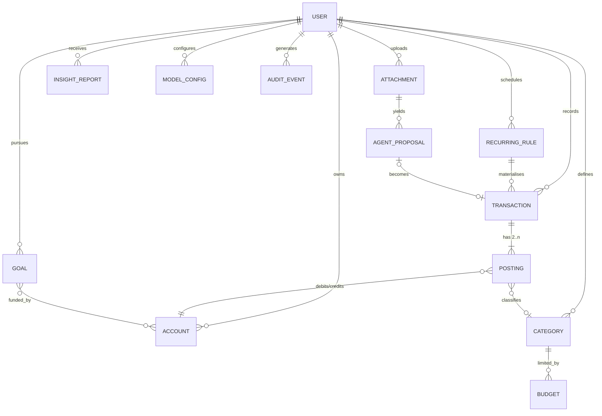
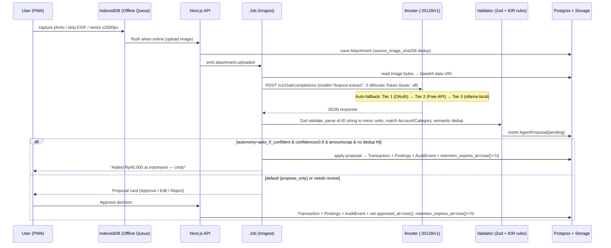
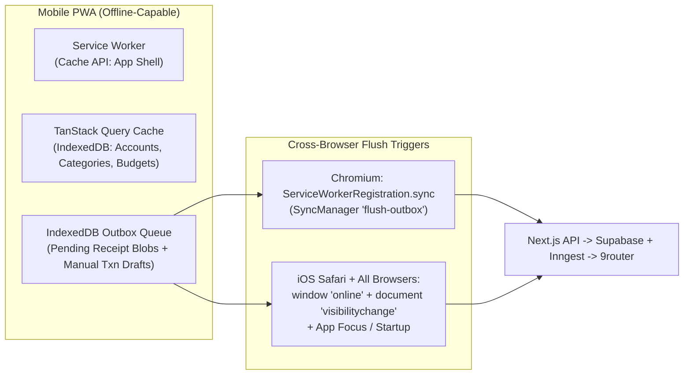

# Research: Agentic Personal Financial Tracker

> Researched and revised 2026-10-26 (UTC+7). Package versions come from the npm registry (`registry.npmjs.org/<pkg>/latest`) on that date. Claims link to the primary source that owns them. Anything **not verified against a primary source** is marked ⚠️.
> No `GLOSSARY.md` or ADRs exist yet. Section 3.4 proposes glossary terms for `/domain-modeling` to adopt or reject.
> **Locked constraints (2026-10-26):** Single-user personal app (`UU PDP Art. 2(2)` household exemption), **100% FREE ($0/mo)** stack, **PWA-first** with IndexedDB offline queue, **IDR-only MVP** (schema ready for multi-currency later), **double-entry postings** behind a simple Expense/Income/Transfer UI, **9router** (`decolua/9router`) for all AI model routing, **`propose_only`** default autonomy mode, configurable `period_start_day`, and **7-day post-approval receipt image retention**.

---

## 1. Summary & recommended stack

**Locked pick (single user, $0/mo budget, web-first PWA, Indonesia / IDR):**

| Layer | Locked recommendation ($0/mo) | Main $0 alternative |
|---|---|---|
| App | **Next.js 16 (App Router) + React 19** as an installable **PWA** (`next` 16.4.3, `react` 19.3.1) with Service Worker Cache API + **IndexedDB** (`idb-keyval` 6.3.0) offline capture queue + **TanStack Query** (`@tanstack/react-query` 5.105.0, `@tanstack/react-query-persist-client` 5.105.0) read-snapshot persistence | Expo SDK 58 (`expo` 58.0.19) if native camera/share-sheet UX becomes critical later |
| AI layer | **Vercel AI SDK v7** (`ai` 7.0.153) + **`@ai-sdk/openai-compatible`** (3.0.78) pointed at **9router** (`9router` 0.5.111, `http://127.0.0.1:20128/v1`). Task aliases (`vision-extract`, `classify`, `insights-narrate`, `chat`) map to **9router Combos** with 3-tier auto-fallback (Subscription OAuth → Free API tiers → Local Ollama) | Direct provider SDKs (`@ai-sdk/google` 4.0.105, `ollama-ai-provider-v2`) without a local router |
| Network topology | **Option A (co-located local/homelab):** Next.js + 9router + Ollama on the user's Mac/homelab, exposed privately to the user's phone via **Tailscale Free** (or **Cloudflare Tunnel Free**). **Option B (hybrid cloud):** Vercel Hobby + Supabase Free + Inngest Free reaching local 9router via **Cloudflare Tunnel** (Zero Trust Service Token) or running 9router on **Oracle Cloud Always Free** | Full VPS self-hosting on Oracle Cloud Always Free ARM (`linux/arm64`) |
| DB & Storage | **Postgres on Supabase Free** (500 MB DB + 1 GB Storage + Auth + RLS + `pg_cron`), **Drizzle ORM** (`drizzle-orm` 0.45.4, pinned) | Local/self-hosted Postgres or SQLite/libSQL (zero cloud pause risk) |
| Jobs & Cron | **Inngest Free** (`inngest` 4.26.0, 50k executions/mo): `TZ=Asia/Jakarta` crons, durable steps, `step.waitForEvent` for proposal expiry, plus daily 7-day image cleanup and Supabase keepalive | **Supabase Cron (`pg_cron`)** inside Postgres (UTC schedules; `08:00 WIB` = `01:00 UTC`) |
| Money | **IDR-only MVP** stored as `bigint` **minor units** plus an ISO 4217 `currency` column (`'IDR'` default) and nullable `fx_rate_to_base` for future multi-currency. Never use `float` or Postgres `money` | `numeric(20,4)` |
| Ledger | **Double-entry postings** (`Σ postings = 0` per transaction) behind a simple **Expense / Income / Transfer** UI | Single-entry table with ad-hoc transfer pairs |
| Recurrence | RFC 5545 RRULE strings evaluated with **`rrule-temporal`** (2.2.8) + `temporal-polyfill` (1.0.6), pinned | `rrule` 2.8.1 (last published 2023-11-10) |
| UI | **Tailwind v4** (4.3.3) + **shadcn/ui** (Recharts v3) + **Motion** (`motion` 14.6.0) | Tremor, visx 4 |
| Receipt OCR | **9router multimodal LLM combo** (`vision-extract`) + strict JSON schema + confidence gate + HITL (`propose_only` default). Optional 100% free local OCR fallback via **`tesseract.js`** (7.0.0, `ind` + `eng` traineddata) | Local Ollama vision models (`qwen2.5vl` / `gemma3`) behind 9router (`ollama-local/*`) |

Why: **9router** (`decolua/9router`) lets a single user unify existing OAuth coding subscriptions, zero-cost API tiers (Kiro, OpenCode Free, Gemini AI Studio, Groq, OpenRouter `:free`), and local Ollama models behind one local OpenAI-compatible `/v1` endpoint with automatic quota tracking and 429 failover — keeping inference at **$0/mo marginal cost**. Combined with the AI SDK's `Output.object()` validation, Supabase Free, and Inngest Free, the **agent proposes, deterministic code disposes**: the LLM never does arithmetic or writes to the ledger without passing validation.

---

## 2. Functional requirements

### 2.1 MVP (Locked scope)

| Area | User stories |
|---|---|
| Single-user auth | Personal app for the user only. Lock authentication to a single allowed email/passkey (allowlist check at sign-in + RLS on `user_id`), while keeping `user_id` columns on every table for future multi-user readiness. |
| Categories | Create/edit/archive categories with `kind ∈ {expense, income}`, optional parent (2 levels), icon and colour. Ship seeded defaults in Indonesian and English (Makan, Transport, Belanja, Tagihan, Gaji…). |
| Budgets | Set a limit per expense category for a configurable budget period (`period_start_day` ∈ `1..28` or `-1` for last day of month, supporting Indonesian payday cycles like the 25th). See spent / remaining / % and pace ("you've used 70% with 40% of the period gone"). Get alerts at configurable thresholds (e.g. 80%, 100%). |
| Accounts | Create accounts of type `cash`, `bank`, `ewallet` (GoPay, OVO, DANA, ShopeePay…), `credit_card`, `other`, with `currency = 'IDR'` in MVP (schema stores ISO 4217 `currency` for future multi-currency) and an opening balance. Balance is computed from double-entry postings. |
| Transactions | Manually add an expense, income or **transfer** (account → account, e.g. BCA → GoPay top-up, with an optional fee posting). Edit, delete (soft/void) and search. Filter by date, account, category. Works offline via the PWA IndexedDB queue (§9.3). |
| Recurring | Define recurring expenses and income (rent, salary, subscriptions) using RRULE. The app materialises upcoming occurrences as *pending*, which are auto-posted or confirmed according to settings. |
| Vision capture | Upload or take a photo of a receipt, transfer screenshot or bank/e-wallet notification (online or queued offline in IndexedDB). When online, the backend sends the preprocessed base64 image through **9router** (`vision-extract` combo) into an **AgentProposal**. Raw receipt images are retained in private storage during review and **deleted 7 days after approval** (`approved_at < now() - interval '7 days'`), keeping the structured transaction and `source_image_sha256` hash. |
| Autonomy modes | Default to **`propose_only`** in MVP. Unlock **`auto_if_confident`** (default threshold `τ = 0.9` + per-category IDR amount cap + zero dedup hits) after ~50 approved proposals. `auto_always` remains gated by deterministic schema/balance checks. |
| Goals | Create a goal with target IDR amount, target date, optional linked account(s). See progress, required monthly saving and on-track status. |
| Insights | Weekly digest (Monday 08:00 WIB) and monthly digest (1st of the budget period). Deterministic SQL/TS metrics plus an LLM narrative routed via 9router (`insights-narrate` combo). Includes overspend warnings and goal progress. |
| Model config | Map each task (`vision-extract`, `classify`, `insights-narrate`, `chat`) to a **9router Combo** or `provider/model` ID (`GET /v1/models` from 9router). Manage provider connections, OAuth tokens, and fallback order in the 9router Dashboard (`http://localhost:20128/dashboard`). |
| UI | Installable mobile-first PWA, animated dashboard, transitions, IDR number tickers ("Rp 45.000", shorthand `45k`/`45rb`/`1,5jt`). Honour reduced-motion settings. |

### 2.2 Later

- Multi-currency UI, FX rate snapshots (`fx_rate_to_base`), and travel mode (schema columns already present in MVP).
- Split transactions (one receipt → several categories) and line-item posting allocation.
- Bank/e-wallet statement import (CSV/PDF), email-forward ingestion, WhatsApp/Telegram bot capture.
- Chat with your finances (read-only analytics tools + proposal write tools via 9router `chat` combo).
- Shared/household budgets (multi-user auth unlock).
- Native app (Expo) and full local-first SQLite sync (PowerSync / ElectricSQL).
- Rollover budgets, envelope/zero-based mode, net-worth tracking, debts and installments ("cicilan", PayLater).
- ⚠️ Direct GoPay/OVO/DANA/ShopeePay data APIs: no consumer-facing personal-statement API was found in primary documentation (only merchant/institutional APIs such as [GoPay Developer Docs](https://gopay.co.id/en/developers) and [DANA SNAP B2B APIs](https://dashboard.dana.id/api-docs-v2/)). Treat screenshots and push notifications as the integration surface.

---

## 3. Domain model / specification

### 3.1 Money invariants

| Rule | Source / rationale |
|---|---|
| Never store money in floating point. `real`/`double precision` are "inexact … some values cannot be converted exactly … and are stored as approximations". | [PostgreSQL numeric types §8.1.3](https://www.postgresql.org/docs/current/datatype-numeric.html) |
| `numeric` is "especially recommended for storing monetary amounts". Integer minor units (`bigint`) are also exact and faster. Pick one and use it everywhere (locked: `bigint` minor units). | [PostgreSQL §8.1.2](https://www.postgresql.org/docs/current/datatype-numeric.html) |
| Avoid the Postgres `money` type: its fractional precision depends on `lc_monetary` and output is locale-sensitive. | [PostgreSQL money type](https://www.postgresql.org/docs/current/datatype-money.html) |
| Amount and currency always travel together as a Money value object. Don't add amounts in different currencies. **MVP is IDR-only (`currency = 'IDR'`), with `currency` and `fx_rate_to_base` columns already in schema so multi-currency requires no destructive migration later.** | [Fowler, *Money* (PoEAA)](https://martinfowler.com/eaaCatalog/money.html) |
| IDR's ISO 4217 minor unit is **2** (numeric code 360), even though IDR prices are shown without decimals in practice. Store the ISO exponent (`amount_minor = Rp * 100`, or document `0`-exponent storage if chosen consistently via an ADR) and format with `Intl.NumberFormat('id-ID', {currency:'IDR', maximumFractionDigits:0})`. | [ISO 4217 List One (SIX, maintenance agency)](https://www.six-group.com/dam/download/financial-information/data-center/iso-currrency/lists/list-one.xml) |
| Amounts in UI/LLM schemas are **positive strings** (`"45.000"`). Direction comes from the entry/transaction type. LLM output is validated (Zod) and parsed to minor units in deterministic code (handling Indonesian `.` thousands separators and `rb`/`jt` shorthand), never by the LLM. | Locked design choice (#4, #11) |
| `Transfer` is not income or expense. It must be excluded from budget and spending analytics. A transfer admin fee (e.g. BI-FAST Rp2.500 or e-wallet top-up Rp1.000) is a third posting leg to an expense category. | Locked design choice (#3) |

**Libraries:** `dinero.js` 2.0.2 (immutable money, currency exponent aware) or a small hand-rolled `Money` value object over `bigint` in `packages/core`.

### 3.2 Single- vs double-entry (Locked: Double-entry postings behind simple UI)

| | Single-entry (txn has `account_id`, `type`, `amount`) | Double-entry (txn has ≥2 postings that sum to zero) |
|---|---|---|
| Simplicity | ✅ Easy UI and queries | ➖ Two tables (`transactions` + `postings`) |
| Transfers | Needs a special `transfer` type with `from`/`to` | Native: two asset postings (`-amount` on source Account, `+amount` on destination Account) |
| Integrity | Balance drift possible | Invariant: $\sum \text{postings} = 0$ per transaction ([Beancount: double-entry method](https://beancount.github.io/docs/the_double_entry_counting_method.html)) |
| Multi-currency, fees, splits | Ad hoc | Natural (e.g., BCA `-Rp101.000`, GoPay `+Rp100.000`, Admin Fee category `+Rp1.000`) |

**Locked decision (#3):** Use the double-entry storage model (`Transaction` + `Posting`) behind a simple **Expense / Income / Transfer** UI. Categories behave like income/expense legs in the posting graph. The user never sees debit/credit jargon.

### 3.3 Entities



| Entity | Key fields | Invariants |
|---|---|---|
| **Account** | id, user_id, name, type (`cash/bank/ewallet/credit_card/other`), provider (e.g. `gopay`, `ovo`, `dana`, `shopeepay`, `bca`), currency (`'IDR'` default), opening_balance_minor, archived_at | Balance = opening + Σ postings. Currency is immutable once postings exist. |
| **Category** | id, user_id, name, kind (`expense/income`), parent_id, icon, colour, auto_approve_cap_minor (nullable), archived_at | Child kind = parent kind. Archive instead of delete when referenced. |
| **Transaction** | id, user_id, occurred_at (timestamptz), local_date (date, user TZ), type (`expense/income/transfer/adjustment`), description, merchant, source (`manual/agent/recurring/import`), status (`pending/posted/void`), dedup_hash, source_image_sha256 (nullable), attachment_id (nullable), recurring_rule_id (nullable), created_by (`user/agent`) | Σ postings = 0 per currency. `transfer` has no category on its asset legs (optional fee leg has an expense category). |
| **Posting** | id, transaction_id, account_id \| category_id, amount_minor (signed `bigint`), currency (`'IDR'`), fx_rate_to_base (`numeric(18,8)`, nullable for future FX) | Exactly one of `account_id` or `category_id` is non-null (`CHECK ((account_id IS NOT NULL) <> (category_id IS NOT NULL))`). |
| **Budget** | id, user_id, category_id, period (`monthly`/`weekly`), period_start_day (`int`, `1..28` or `-1` for last day of month), amount_minor, currency (`'IDR'`), start_date, rollover (bool), alert_thresholds int[] | Expense categories only. One active per category and period. |
| **RecurringRule** | id, user_id, template (JSON: type, amount_minor, account_id, category_id, merchant), rrule (RFC 5545 text), dtstart (local ISO), tzid (`Asia/Jakarta`), until/count, mode (`auto_post/confirm`), next_run_at, last_materialised_at | Idempotent materialisation via unique `(rule_id, occurrence_date)`. |
| **Goal** | id, user_id, name, target_minor, currency (`'IDR'`), target_date, start_date, linked_account_ids, priority, status | `target_date > start_date`. |
| **Attachment** | id, user_id, storage_object_path (nullable after expiry), mime, source_image_sha256, byte_size, width/height, exif_stripped, approved_at (nullable timestamptz), retention_expires_at (nullable timestamptz), deleted_from_storage_at (nullable timestamptz) | Unique `(user_id, source_image_sha256)` gives first-line image dedup even after the blob is purged 7 days post-approval (#10). |
| **AgentProposal** | id, user_id, attachment_id, kind (`create_transaction/update/link_transfer`), payload (JSON, schema-versioned), field_confidences, overall_confidence, model_id (e.g. `finance-extract -> kr/claude-sonnet-4.5`), prompt_version, status (`pending/approved/edited/rejected/auto_applied/expired`), decided_by, decided_at, resulting_transaction_id | Applying is idempotent (unique `resulting_transaction_id`). The payload is validated against the same Zod schema as manual input. |
| **InsightReport** | id, user_id, period (`week/month`), period_start, metrics (JSON, deterministic), narrative (markdown/JSON), model_id, generated_at | `metrics` is the source of truth. The narrative may only cite numbers present in `metrics`. |
| **ModelConfig** | id, user_id, task (`vision-extract/classify/insights-narrate/chat`), target_model_or_combo (e.g. `finance-extract`), base_url (`http://127.0.0.1:20128/v1`), params (temperature, max_tokens), updated_at | Points at a 9router Combo name or `provider/model` string; upstream OAuth/API credentials stay inside 9router's local SQLite store (`~/.9router/db/data.sqlite`). |
| **AuditEvent** | id, user_id, actor (`user/agent/system`), action, entity, entity_id, before, after, proposal_id, at | Append-only. |

### 3.4 Proposed GLOSSARY terms

| Term | Definition | Avoid |
|---|---|---|
| **Account** | A place where money lives (cash wallet, bank account, e-wallet, card). | "wallet" as a generic term |
| **E-wallet** | Account type for server-based e-money licensed by Bank Indonesia as a Payment Service Provider / PJP (e.g., GoPay by PT Dompet Anak Bangsa, OVO by PT Visionet Internasional, DANA by PT Espay Debit Indonesia Koe, ShopeePay by PT Airpay International Indonesia — see §12 #14). | "e-money" in UI (Indonesians often use "e-money" specifically for Mandiri's NFC card) |
| **Category** | A user-defined classification with kind *expense* or *income*. | "tag" (reserve for free-form labels) |
| **Transaction** | A dated financial event made of balanced **Postings**. | "entry" |
| **Posting** | A single signed leg (`amount_minor`) of a Transaction against one Account or one Category. | "line" (confuses with receipt line items) |
| **Transfer** | A Transaction that moves money between the user's own Accounts. It is never income or expense (except an optional fee Posting). | "expense" for top-ups |
| **Budget** | A spending limit for one expense Category per **BudgetPeriod**. | "limit" alone |
| **BudgetPeriod** | A concrete date window `[start_date, end_date]` in `Asia/Jakarta` derived from `period_start_day` (`1..28` or `-1` for last day of month). | "month" (since payday cycles cross calendar months) |
| **RecurringRule** | An RRULE-based template that materialises Transactions. | "subscription" (that's a category) |
| **Occurrence** | One materialised date of a RecurringRule. | |
| **Goal** | A target amount by a target date. | "saving" |
| **AgentProposal** | An agent-suggested ledger change awaiting or having received a user/autonomy decision. | "draft", "suggestion" |
| **AutonomyMode** | User setting (`propose_only`, `auto_if_confident`, `auto_always`) for whether AgentProposals are auto-applied. | |
| **Attachment** | An uploaded receipt/screenshot metadata record (`source_image_sha256`, `retention_expires_at`, nullable `storage_object_path`). | "file", "image" |
| **Combo** | A named, ordered list of `provider/model` targets in **9router** that automatically falls back on rate limits, quota exhaustion, or capability mismatch. | "chain" |
| **InsightReport** | Weekly/monthly deterministic metrics plus an LLM narrative. | "AI report" |
| **AuditLog** | An append-only record (`AuditEvent` row) of who (`user/agent/system`) changed which entity, with before/after snapshots and `proposal_id`. | "history" |
| **Minor units** | Integer amount in the currency's smallest ISO 4217 unit (`IdrMinorUnits`). | "cents" |

---

## 4. Recurring rules & budget cycles

- **Spec:** iCalendar RRULE, [RFC 5545 §3.3.10 "Recurrence Rule"](https://www.rfc-editor.org/rfc/rfc5545#section-3.3.10). Examples: `FREQ=MONTHLY;BYMONTHDAY=25` (salary / payday), `FREQ=MONTHLY;BYMONTHDAY=-1` (last day of month), `FREQ=WEEKLY;BYDAY=MO`.
- **Gotcha (normative):** "Recurrence rules may generate recurrence instances with an invalid date (e.g., February 30) … Such recurrence instances MUST be ignored and MUST NOT be counted" ([RFC 5545 §3.3.10](https://www.rfc-editor.org/rfc/rfc5545#section-3.3.10)). `BYMONTHDAY=31` therefore **skips** short months. For "rent on the 31st or the last day", use `BYMONTHDAY=-1` or `BYMONTHDAY=28,29,30,31;BYSETPOS=-1`. Expose this in the UI as "last day of month".
- **Custom budget payday cycles (Locked #9):** Budgets store `period_start_day` (`1..28` or `-1`). A payday cycle starting on the 25th (`period_start_day = 25`) runs from `YYYY-MM-25` (inclusive) through the `24th` of the following month in `Asia/Jakarta` local dates. Computing the current period window via `Temporal.PlainDate` (`temporal-polyfill` 1.0.6) avoids month-length bugs.
- **DTSTART and RRULE are separate properties** ([RFC 5545](https://www.rfc-editor.org/rfc/rfc5545); also called out in [rrule-temporal README](https://github.com/ggaabe/rrule-temporal)). Store `dtstart` local time + `tzid` + `rrule` separately.
- **Libraries (pinned per #13):**

| Lib | Notes |
|---|---|
| [`rrule`](https://github.com/jkbrzt/rrule) 2.8.1 | Most used. Deals in "floating" or UTC times, and "returned 'UTC' dates are always meant to be interpreted as dates in your local timezone" ([README](https://github.com/jkbrzt/rrule)). Footgun-prone. Last npm publish was 2023-11-10. |
| [`rrule-temporal`](https://github.com/ggaabe/rrule-temporal) 2.2.8 | RFC 5545 on top of `Temporal.ZonedDateTime`, so it is TZ-correct. Actively published (2026-10-01). **Locked pick.** |
| `Temporal` | Native API with `ZonedDateTime`/`PlainDate`, but MDN marks it "**Limited availability** … not Baseline" ([MDN Temporal](https://developer.mozilla.org/en-US/docs/Web/JavaScript/Reference/Global_Objects/Temporal)). Use `temporal-polyfill` (1.0.6). |

- **Timezone:** `Asia/Jakarta` (WIB, UTC+7, no DST). Still store IANA `tzid` per user and rule. Store `occurred_at` as `timestamptz` and a derived `local_date` for budget/period bucketing, so a 23:30 WIB purchase lands in the correct day/period.
- **Materialisation:** a daily job creates occurrences for the next N days with unique `(rule_id, occurrence_date)`. `auto_post` → `posted`. `confirm` → `pending` plus a notification.

---

## 5. Agent architecture (via 9router)

### 5.1 End-to-end receipt & proposal flow



### 5.2 Deep dive: What 9router is and how it works (Primary-source findings)

[**9Router**](https://github.com/decolua/9router) ([npm `9router` `0.5.111`](https://www.npmjs.org/package/9router), website [9router.com](https://9router.com), MIT license, port of Go's `CLIProxyAPI`) is a self-hosted **Next.js 16 + Node.js 20+ + SQLite** (`${DATA_DIR}/db/data.sqlite`, defaulting to `~/.9router/db/data.sqlite`) smart AI proxy and router (`open-sse` engine). It runs on default port **`20128`**, serving a management dashboard at `http://localhost:20128/dashboard` and API routes under `http://localhost:20128/v1` ([`decolua/9router` README](https://github.com/decolua/9router/blob/master/README.md)).

| Capability | Primary-source verification (`decolua/9router` `master`) | Architectural impact on our tracker |
|---|---|---|
| **Exposed endpoints** | [`src/app/api/v1/`](https://github.com/decolua/9router/tree/master/src/app/api/v1) exposes: `POST /v1/chat/completions` (OpenAI Chat), `POST /v1/messages` and `/v1/messages/count_tokens` (Anthropic Messages), `POST /v1/responses` and `/v1/responses/compact` (OpenAI Responses), `GET /v1/models` (lists all provider models **plus user-defined Combos** in OpenAI format), `/v1/embeddings`, `/v1/images/generations`, `/v1/audio/transcriptions`, `/v1/audio/speech`, and `/v1beta/models` (Gemini format). | We connect Vercel AI SDK v7 via `@ai-sdk/openai-compatible` (`3.0.78`) pointed at `NINEROUTER_BASE_URL` (`http://127.0.0.1:20128/v1`). |
| **Provider categories** | [`open-sse/providers/registry/`](https://github.com/decolua/9router/tree/master/open-sse/providers/registry) registers 100+ provider definitions across 4 categories: **(1) OAuth subscriptions** (`cc/` Claude Code, `cx/` OpenAI Codex, `gh/` GitHub Copilot, `cu/` Cursor, `ag/` Antigravity, `km/` Kimchi); **(2) Free tiers** (`kr/` Kiro AI, `oc/` OpenCode Free, `vertex/` GCP Vertex AI, `gemini/` Google AI Studio, `openrouter/` OpenRouter `:free`, `groq/` Groq); **(3) Cheap/Paid API keys** (`glm/`, `minimax/`, `kimi/`, `deepseek/`, `openai/`, `anthropic/`); **(4) Local/Self-hosted** (`ollama-local/` → `http://localhost:11434/api/chat` via [`open-sse/executors/ollama-local.js`](https://github.com/decolua/9router/blob/master/open-sse/executors/ollama-local.js), plus `selfhosted-stt`, `selfhosted-tts`, `selfhosted-embedding`). | **Important 2026 deprecation note ([README #L403, #L891-L896](https://github.com/decolua/9router/blob/master/README.md)):** iFlow (`if/`), Qwen Code (`qw/`, shut down by Alibaba on 2026-04-15), and Gemini CLI (`gc/`, shut down by Google on 2026-06-18) free OAuth tiers were **discontinued in 2026**. Use `kr/` (Kiro), `gemini/` (AI Studio API key), `groq/`, `openrouter/`, `oc/`, or `ollama-local/` for free tiers instead. |
| **Combos & capability-aware routing** | [`open-sse/services/combo.js`](https://github.com/decolua/9router/blob/master/open-sse/services/combo.js) supports `fallback`, `round-robin` (with `stickyLimit`), and `fusion` (parallel panel + judge model) strategies. Crucially, `detectRequiredCapabilities(body)` and `reorderByCapabilities(models, required)` (`combo.js#L253-L272`) inspect the trailing user turn for `HARD_CAPS = new Set(["vision", "pdf", "audioInput", "videoInput"])`. If an image is present, 9router **automatically reorders combo models** so vision-capable models (`tier 0/1`) run before text-only models (`tier 2`). | Even if a user accidentally puts a text-only model inside a Combo, 9router prioritizes vision-capable members on receipt upload calls without dropping fallbacks. |
| **429 / Quota & Empty-Stream Failover** | [`open-sse/services/accountFallback.js`](https://github.com/decolua/9router/blob/master/open-sse/services/accountFallback.js) (`checkFallbackError`) matches `401/402/403/429` and provider quota strings, placing exhausted accounts into exponential backoff (`getQuotaCooldown`) and rotating to the next account or next combo model. Request-scoped `400` errors set `requestScoped: true` (`accountFallback.js#L139`), rotating to the next combo model **without** locking the healthy credential. `peekComboResponse` (`combo.js#L188`) peeks SSE streams and fails over if a 2xx stream yields empty content. | Zero-downtime receipt extraction and weekly digests when a subscription window (e.g. Claude 5-hour cap) or free-tier RPM limit is hit. |
| **Vision / image input & SSRF guard** | [`open-sse/translator/concerns/image.js`](https://github.com/decolua/9router/blob/master/open-sse/translator/concerns/image.js) and [`open-sse/config/mediaConfig.js`](https://github.com/decolua/9router/blob/master/open-sse/config/mediaConfig.js) accept OpenAI `image_url` blocks (`data:image/<ext>;base64,...` or remote URLs up to `MAX_IMAGE_BYTES = 10 MB`, verified by magic bytes for PNG, JPEG, GIF, WebP, BMP) and translate them to Claude `base64` blocks (`openai-to-claude.js#L257`), Gemini `inlineData`, Kiro `pendingImages` bytes (`openai-to-kiro.js#L119`), or Ollama `message.images[]` (`openai-to-ollama.js#L174`). **Critical gotcha:** `isPrivateIp` and `BLOCKED_HOSTS` (`image.js#L20-L43`, `mediaConfig.js#L22-L29`) reject `localhost`, `127.0.0.1`, RFC 1918 (`10.x`, `172.16-31.x`, `192.168.x`), and Tailscale CGNAT (`100.64.0.0/10`) URLs to prevent SSRF! | **Never pass a local, Tailscale, or private-bucket URL in `image_url` to 9router.** Always read the attachment bytes in the backend worker and pass a **`Uint8Array` / `data:image/jpeg;base64,...` data URI** so 9router's `parseDataUri()` (`image.js#L8`) processes it inline without network fetching. |
| **Structured output (`response_format`) vs Tool calling** | Inspection of [`open-sse/translator/request/`](https://github.com/decolua/9router/tree/master/open-sse/translator/request) and [`open-sse/executors/default.js`](https://github.com/decolua/9router/blob/master/open-sse/executors/default.js) shows: (1) Native OpenAI-format providers (`openai/`, `openrouter/`, `groq/`, `glm/`) receive `body.response_format` directly; (2) `openai-compatible-*` (`default.js#L121-L138`) and Claude (`openai-to-claude.js#L118-L126`) convert `response_format.type === "json_schema"` into a system-prompt JSON schema instruction; (3) **`openai-to-gemini.js`, `openai-to-kiro.js`, and `openai-to-ollama.js` do NOT translate `body.response_format`**, whereas **all** translators implement full `body.tools` + `body.tool_choice` translation! | When using `Output.object({ schema })` across heterogeneous 9router combos (which may fall back to `kr/*`, `gemini/*`, or `ollama-local/*`), **do not rely solely on wire-level `response_format`**. Configure the AI SDK call to inject the JSON schema into the system prompt (or use a single-tool forced call) AND send header `X-9Router-Token-Saver: off` ([`README.md#L556`](https://github.com/decolua/9router/blob/master/README.md)) so Caveman/Ponytail prompt injectors never alter strict JSON output. |
| **Authentication & API keys** | [`src/sse/handlers/chat.js#L60-L100`](https://github.com/decolua/9router/blob/master/src/sse/handlers/chat.js) checks `Authorization: Bearer <key>` when `REQUIRE_API_KEY=true` (or Dashboard toggle `requireApiKey` is enabled). Keys are created in Dashboard → API Keys (`/api/keys`) and support per-key model/combo allowlists (`src/sse/services/keyAccess.js`). | Generate a dedicated 9router API key restricted to `finance-*` combos, set `REQUIRE_API_KEY=true`, and store it in `.env.local` / Supabase Vault. |

### 5.3 Design rules

| Concern | Recommendation |
|---|---|
| **Structured output over 9router** | In AI SDK v7 (`ai` 7.0.153), use `generateText` with `output: Output.object({ schema })` (`generateObject`/`streamObject` were **deprecated in v6**: [AI SDK 6 migration](https://ai-sdk.dev/docs/migration-guides/migration-guide-6-0); [Structured data](https://ai-sdk.dev/docs/ai-sdk-core/generating-structured-data)). Because 9router's Kiro (`openai-to-kiro.js`), Gemini (`openai-to-gemini.js`), and Ollama (`openai-to-ollama.js`) translators ignore `body.response_format` (§5.2), instantiate `createOpenAICompatible({ name: '9router', baseURL: process.env.NINEROUTER_BASE_URL, apiKey: process.env.NINEROUTER_API_KEY, headers: { 'X-9Router-Token-Saver': 'off' } })` (where `supportsStructuredOutputs` defaults to `false`, causing the AI SDK to inject the JSON schema instruction into the prompt and validate with Zod on return) or strip optional `\`\`\`json` fences in a response middleware before Zod validation. |
| **Receipt schema (IDR-hardened)** | `{ doc_type: 'receipt'\|'transfer'\|'notification'\|'other', merchant: string, occurred_at_local: string, currency: 'IDR', total_raw: string, subtotal_raw?: string, tax_raw?: string, service_charge_raw?: string, discount_raw?: string, fee_raw?: string, payment_method_hint?: string (e.g. "GoPay", "QRIS BCA", "Mandiri ****1234"), counterparty?: string, reference_id?: string, line_items?: [{ name: string, qty: number, unit_price_raw: string, line_total_raw: string }], suggested_category_id: string, is_transfer_between_own_accounts: boolean, field_confidence: Record<string, number>, notes?: string }`. Require the model to return all monetary amounts as **verbatim strings** (`"45.000"`, `"1.250.000"`) — parsed in deterministic TypeScript (`parseIdrToMinorUnits`) and cross-checked (`subtotal + tax + service - discount == total`). |
| **Tools** (agent mode / chat) | Read tools: `list_accounts`, `list_categories`, `search_transactions`, `get_budget_status`, `get_goal_progress`. Write tools: `propose_transaction` and `propose_transfer` only. They create `AgentProposal` rows and never mutate `transactions`/`postings` directly. Note that 9router's RTK Token Saver automatically compresses large `tool_result` payloads by 20–40% in chat loops ([`open-sse/AGENTS.md`](https://github.com/decolua/9router/blob/master/open-sse/AGENTS.md)). |
| **HITL** | AI SDK v7 `toolApproval` on `generateText`/`streamText`/`ToolLoopAgent`, with statuses `not-applicable`, `approved`, `denied` and `user-approval` (`needsApproval` on `tool()` is **deprecated in v7**: [Tools: Tool Execution Approval](https://ai-sdk.dev/docs/ai-sdk-core/tools-and-tool-calling); [v7 migration](https://ai-sdk.dev/docs/migration-guides/migration-guide-7-0)). **For the receipt pipeline, persist Proposals in your own `agent_proposals` table** rather than relying on in-memory agent state. Approvals can take days. |
| **Autonomy modes (Locked #5)** | Default to **`propose_only`** (all proposals start as `pending`). Unlock **`auto_if_confident`** later: auto-apply when `overall_confidence ≥ τ` (`τ = 0.9`), `amount_minor ≤ category.auto_approve_cap_minor`, account and category resolved, and zero semantic dedup candidates. `auto_always` is still blocked by deterministic validation or balance-check failures. Every auto-apply gets a 1-tap **Undo** (void + audit). |
| **Confidence** | LLM self-reported confidence is uncalibrated ⚠️ (no primary source guarantees calibration). Combine it with deterministic checks: `total == Σ line_items ± tax/service/discount`, date within ±7 days of upload, `currency == 'IDR'`, merchant/account resolved by exact or fuzzy match. Track the approval-without-edit rate per 9router model (`model_id` recorded on `AgentProposal`) to tune `τ`. |
| **Idempotency / dedup (Locked #10, #12)** | (1) `source_image_sha256` unique per user on `attachments` (persisted permanently even after the image file is deleted 7 days post-approval). (2) Semantic dedup on `(account_id, amount_minor, local_date ± 1 day, normalised merchant or reference_id)`. A QRIS/BI-FAST transfer screenshot and a paper receipt for the same purchase trigger a `link_transfer` / merge proposal instead of double-counting. (3) Apply proposals with an idempotency key (`proposal.id`), following Stripe's [idempotent requests pattern](https://stripe.com/docs/api/idempotent_requests). (4) Use `(rule_id, occurrence_date)` for recurring occurrences. |
| **Audit** | Append-only `AuditEvent` with `actor`, before/after, `model_id` (from 9router response `model` field), `prompt_version` and `proposal_id`. Keep the raw model output JSON on `AgentProposal` for debugging and evals. |
| **Prompt injection** | Images are untrusted input. Text inside a receipt can carry instructions. OWASP LLM01 lists **"4. Enforce privilege control and least privilege access"** and **"5. Require human approval for high-risk actions"** as core mitigations ([OWASP Top 10 for LLM Apps v2.0 – LLM01 Prompt Injection](https://github.com/OWASP/www-project-top-10-for-large-language-model-applications/blob/main/2_0_vulns/LLM01_PromptInjection.md)). The extraction call has **no tools**; only Zod-validated JSON flows onward. |

### 5.4 Framework & router comparison

| Component | Role | Structured output | HITL primitive | Cost | Fit for our locked stack |
|---|---|---|---|---|---|
| **Vercel AI SDK v7** (`ai` 7.0.153) + **`@ai-sdk/openai-compatible`** (3.0.78) | App-side TypeScript SDK calling 9router | `Output.object` (Zod) | `toolApproval` (`user-approval`) + DB `AgentProposal` | $0 (MIT) | ⭐ **Locked app-side SDK** |
| **9Router** (`9router` 0.5.111, `decolua/9router`) | Local/self-hosted OpenAI-compatible AI router (`:20128/v1`) across OAuth, Free APIs, and local Ollama | Passthrough (`DefaultExecutor`) + system-prompt schema injection (`openai-to-claude.js`) | Passthrough (`tools` translated across OpenAI/Claude/Gemini/Kiro/Ollama) | $0 (MIT) | ⭐ **Locked model router** |
| **Mastra** (`@mastra/core` 1.79.0) | Full agent framework with `suspend()` / resume workflows ([HITL](https://mastra.ai/docs/workflows/human-in-the-loop)) | Zod | Workflow `suspend()` | $0 (OSS core) | Heavier than needed when Inngest + AI SDK + 9router already handle durability & routing |
| **LiteLLM** | Python LLM proxy ([docs](https://docs.litellm.ai/docs/)) | Passthrough | – | $0 (OSS) | Redundant since user standardized on **9router** (Node.js/Next.js) |

---

## 6. Vision / receipt OCR (100% Free via 9router)

### 6.1 Free vision options compared

Because the stack is strictly **$0/mo**, paid cloud OCR APIs (Google Document AI at \$0.10/doc, AWS Textract — which [does not support Indonesian (`id`)](https://docs.aws.amazon.com/textract/latest/dg/limits-document.html), and paid Azure tiers) are excluded from the runtime path. All receipt, e-wallet screenshot, and push-notification extraction runs through **9router** at $0 marginal cost:

| Option (all $0/mo) | Indonesian/IDR & e-wallet layout support | Output | Quota / limits | Notes & primary sources |
|---|---|---|---|---|
| **9router Multimodal Cloud Models** (`gemini/gemini-2.5-flash`, `kr/claude-sonnet-4.5`, `cc/claude-sonnet-4-6`, `gh/gpt-5.4`, `openrouter/*:free`) | Understands mixed Indonesian/English thermal receipts (Indomaret, Alfamart, restaurants), QRIS/BI-FAST transfer screenshots (BCA myBCA/m-BCA, Mandiri Livin', BRI BRImo), and GoPay/OVO/DANA/ShopeePay notifications in a single pass ⚠️ (accuracy should be verified on a 50-receipt personal eval set) | Strict JSON matching our `ReceiptSchema` | Subject to 9router Combo fallback across OAuth subscriptions and free tiers (§7.3). 9router caps remote image fetches at **10 MB** ([`mediaConfig.js`](https://github.com/decolua/9router/blob/master/open-sse/config/mediaConfig.js)); Gemini inline requests cap at **20 MB** ([Image understanding](https://ai.google.dev/gemini-api/docs/image-understanding)). | **Primary pipeline.** Send preprocessed image as base64 data URI (`≤300 KB` after resize) so it works across all 9router translators (`openai-to-claude.js`, `openai-to-gemini.js`, `openai-to-kiro.js`). |
| **9router Local Ollama Vision** (`ollama-local/qwen2.5vl:7b` or `ollama-local/gemma3:12b`) | Zero-egress local extraction on Apple Silicon Mac | JSON | Unlimited ($0, offline-capable when app + 9router + Ollama run locally) | 9router's [`openai-to-ollama.js`](https://github.com/decolua/9router/blob/master/open-sse/translator/request/openai-to-ollama.js) extracts base64 from OpenAI `image_url` blocks into Ollama's `message.images[]` ([Ollama vision](https://docs.ollama.com/capabilities/vision)). Ideal Tier 3 fallback or privacy-first mode. |
| **Local `tesseract.js` v7** (`tesseract.js` 7.0.0, WASM) | Supports Indonesian (`ind`) and English (`eng`) traineddata models (`[Tesseract languages](https://tesseract-ocr.github.io/tessdoc/Data-Files-in-different-versions.html)`) | Raw OCR text lines + word bounding boxes/confidences | Unlimited ($0, runs in browser or Node.js) | Optional pre-pass if a fallback model in 9router is text-only, or as a deterministic sanity check that the `total_raw` string actually appears in the image text. Poor on stylized e-wallet UI screenshots by itself. |

**Locked recommendation:** Use **9router multimodal LLM (`vision-extract` combo)** as the primary pipeline with a strict Zod schema and deterministic post-validation (`total == Σ items ± tax/discounts`). Build a small **eval set** (~30–50 real receipts, QRIS screenshots, and e-wallet notifications from BCA/Mandiri/GoPay/OVO/DANA/ShopeePay) and run it through your 9router combo models to benchmark field accuracy and calibrate `τ = 0.9`.

### 6.2 Image preprocessing & 9router base64 transport

1. **Client-side preprocessing (before IndexedDB storage or upload):** Resize the long edge to **1500–2000 px**, compress to **JPEG/WebP at 0.8 quality** (~150–350 KB per receipt), auto-orient, and **strip EXIF metadata (including GPS coordinates)** by redrawing onto an HTML5 `<canvas>` (`OffscreenCanvas` / `canvas.toBlob('image/jpeg', 0.8)`).
2. **Inline base64 transport to 9router:** As verified in [`open-sse/translator/concerns/image.js#L20-L53`](https://github.com/decolua/9router/blob/master/open-sse/translator/concerns/image.js), 9router's remote URL fetcher (`fetchImageAsBase64`) blocks private/local/Tailscale IPs (SSRF protection) and Supabase private bucket URLs require signed tokens. Always pass the image bytes from the backend job to the AI SDK as a `Uint8Array` or `data:image/jpeg;base64,...` string so 9router's `parseDataUri()` parses it in-memory.

### 6.3 7-day receipt image retention policy (Locked #10)

Receipts and transfer screenshots contain account numbers, counterparty names, and reference IDs.
- **Storage during review:** Uploaded images are stored in a private Supabase Storage bucket (`receipts`, RLS restricted to `auth.uid()`) with `source_image_sha256` recorded on `attachments`.
- **7-day post-approval retention:** When a proposal is approved (or auto-applied), the database sets `attachments.approved_at = now()` and `attachments.retention_expires_at = now() + interval '7 days'`.
- **Automated daily purge:** A daily scheduled job (§8.1) queries `attachments WHERE retention_expires_at < now() AND storage_object_path IS NOT NULL` (plus rejected/expired proposals older than 7 days), deletes the objects from Supabase Storage via `storage.from('receipts').remove([...])`, sets `storage_object_path = null` and `deleted_from_storage_at = now()`, and **retains the `attachments` metadata row (`source_image_sha256`) and the structured `Transaction`/`Posting` rows forever** so duplicate uploads of the same screenshot weeks later are still caught by SHA-256 deduplication and the 1 GB free storage quota is never exhausted.

---

## 7. Configurable AI models & 9router inference economics

### 7.1 AI SDK + 9router integration pattern

Instead of managing multiple provider SDKs and API keys inside the financial tracker, the app talks exclusively to **9router** (`http://127.0.0.1:20128/v1`) using `@ai-sdk/openai-compatible` (`3.0.78`) and AI SDK v7's `customProvider` ([Provider management](https://ai-sdk.dev/docs/ai-sdk-core/provider-management), [OpenAI-Compatible Providers](https://ai-sdk.dev/providers/openai-compatible-providers)):

```ts
// packages/ai/src/registry.ts
import { createOpenAICompatible } from '@ai-sdk/openai-compatible';
import { customProvider } from 'ai';

const nineRouterBase = createOpenAICompatible({
  name: '9router',
  baseURL: process.env.NINEROUTER_BASE_URL ?? 'http://127.0.0.1:20128/v1',
  apiKey: process.env.NINEROUTER_API_KEY ?? 'sk_9router_local',
  headers: {
    // Prevent Caveman/Ponytail token savers from mutating structured JSON output
    // Source: https://github.com/decolua/9router/blob/master/README.md#L556
    'X-9Router-Token-Saver': 'off',
  },
});

// Map logical financial tasks to 9router Combo names (or provider/model IDs)
export const financeAI = customProvider({
  languageModels: {
    'vision-extract': nineRouterBase(process.env.MODEL_VISION_EXTRACT ?? 'finance-extract'),
    'classify':       nineRouterBase(process.env.MODEL_CLASSIFY ?? 'finance-classify'),
    'insights-narrate': nineRouterBase(process.env.MODEL_INSIGHTS ?? 'finance-narrate'),
    'chat':           nineRouterBase(process.env.MODEL_CHAT ?? 'finance-chat'),
  },
  fallbackProvider: nineRouterBase,
});
```

In the tracker's **Settings → AI Models** screen, the backend fetches `GET ${NINEROUTER_BASE_URL}/models` (which returns all connected `provider/model` entries and custom Combos configured in 9router: [`src/app/api/v1/models/route.js`](https://github.com/decolua/9router/blob/master/src/app/api/v1/models/route.js)) so the user can reassign any task alias (`vision-extract`, `classify`, `insights-narrate`, `chat`) from a dropdown without redeploying.

### 7.2 Network topology: How the PWA & background jobs reach 9router ($0/mo)

Because **9router** stores OAuth credentials and quota state in a local SQLite database (`~/.9router/db/data.sqlite`) and optionally talks to local Ollama (`http://localhost:11434`), we must choose how the mobile PWA and scheduled jobs reach it.

| Dimension | **Option A (Recommended for MVP): Co-located Self-Hosted App + 9router via Tailscale / Cloudflare Tunnel** | **Option B1: Cloud PWA (Vercel + Supabase + Inngest) → Tunnel to Local 9router** | **Option B2: 9router + App on Oracle Cloud Always Free ARM VM** |
|---|---|---|---|
| **How it works** | Next.js PWA server, 9router (`:20128`), and Ollama (`:11434`) all run on the user's Mac or always-on home mini-PC. The user's phone accesses the Next.js PWA over **Tailscale** (`https://<machine>.<tailnet>.ts.net` via `tailscale serve`) or **Cloudflare Tunnel** (`cloudflared` + Cloudflare Access email/passkey policy). Next.js calls 9router over loopback (`http://127.0.0.1:20128/v1`). | Next.js runs on Vercel Hobby; DB/Storage on Supabase Free; crons on Inngest Free. The user's machine runs `9router` + `cloudflared` tunnel (`https://ai-proxy.yourdomain.com`) protected by **Cloudflare Zero Trust Service Auth** (`CF-Access-Client-Id` + `CF-Access-Client-Secret` headers) + `REQUIRE_API_KEY=true`. | Run Dockerized `decolua/9router:latest` (`linux/arm64`) + Next.js on an **Oracle Cloud Always Free** Ampere A1 VM (up to 4 OCPUs, 24 GB RAM, 200 GB storage: [Oracle Cloud Free Tier](https://www.oracle.com/cloud/free/)). |
| **Monthly cost** | **$0/mo** ([Tailscale Personal Plan](https://tailscale.com/pricing): free for up to 6 users & unlimited user devices; [Cloudflare Zero Trust Free](https://www.cloudflare.com/plans/zero-trust-services/): free up to 50 users). | **$0/mo** (Vercel Hobby + Supabase Free + Inngest Free + Cloudflare Tunnel Free). | **$0/mo** (Oracle Always Free + Supabase Free or local Postgres). |
| **9router security** | ⭐ **Highest:** Port `20128` never leaves `127.0.0.1`. Only the Next.js app is reachable on the private tailnet. | Good if gated by **both** Cloudflare Access Service Token headers at the edge and `REQUIRE_API_KEY=true` in 9router. Never expose port `20128` publicly without `REQUIRE_API_KEY=true` (`INITIAL_PASSWORD` defaults to `123456`: [`README.md#L1333`](https://github.com/decolua/9router/blob/master/README.md)). | Good if `20128` is bound to `127.0.0.1` inside the VM/Docker network. |
| **When user's Mac sleeps** | PWA opens offline from Service Worker cache and queues receipts/transactions in **IndexedDB** (§9.3); syncs and runs 9router vision extraction as soon as the Mac wakes or user returns home. | Vercel UI and manual DB writes work 24/7 via Supabase; receipt AI extraction and Inngest LLM narratives wait/retry until the user's Mac (running 9router) is online. | Runs 24/7 in the cloud, **but** no Apple Silicon GPU for fast local Ollama vision models, and some OAuth providers flag datacenter IPs. |

**Recommended $0 topology:**
- **Start with Option A (Tailscale Serve on Mac/homelab)** if you want zero cloud configuration and local Ollama (`ollama-local/*`) over loopback, **or Option B1 (Vercel Hobby + Supabase Free + Inngest Free + Cloudflare Tunnel to local 9router)** if you want manual transactions, budgets, and read dashboards available 24/7 on your phone even when your laptop is asleep (with Inngest automatically retrying queued receipt vision jobs when your laptop wakes up). Both use the exact same codebase and environment variables (`NINEROUTER_BASE_URL`, `NINEROUTER_API_KEY`).

### 7.3 Deep dive (#7): Who pays for inference & how $0 3-Tier routing works in 9router

For a single user on a strict **$0/mo** budget, **9router itself is 100% free, open-source software that never charges or bills you** (the dollar figures in 9router's Usage Analytics dashboard are a simulated "savings tracker" estimating what those tokens would have cost at list API prices: [`decolua/9router` README #L696-L706, #L738-L772](https://github.com/decolua/9router/blob/master/README.md)).

Inference is organized into **three $0 marginal-cost tiers** inside 9router:

#### Tier 1: Existing Paid Subscriptions via OAuth ($0 marginal cost)
- **Providers in 9router:** Claude Code (`cc/claude-sonnet-4-6`, `cc/claude-haiku-4-5-20251001`, `cc/claude-opus-4-7`), OpenAI Codex (`cx/gpt-5.4`, `cx/gpt-5.3-codex`), GitHub Copilot (`gh/gpt-5.4`, `gh/claude-sonnet-4.6`, `gh/gemini-3.1-pro-preview`), Cursor (`cu/`), Antigravity (`ag/`).
- **How quota works:** If the user already pays for one of these subscriptions for daily coding, routing personal finance tasks through it costs **$0 extra**. 9router tracks rolling 5-hour, daily, and weekly reset windows per model and auto-refreshes OAuth PKCE tokens ([`README.md#L633-L659`](https://github.com/decolua/9router/blob/master/README.md)).
- **Upstream ToS & account-ban risk (Primary-source warning):** In 9router's own provider registry ([`open-sse/providers/registry/claude.js#L147`](https://github.com/decolua/9router/blob/master/open-sse/providers/registry/claude.js), [`codex.js#L178`](https://github.com/decolua/9router/blob/master/open-sse/providers/registry/codex.js), [`github.js#L197`](https://github.com/decolua/9router/blob/master/open-sse/providers/registry/github.js), [`kiro.js#L119`](https://github.com/decolua/9router/blob/master/open-sse/providers/registry/kiro.js)), OAuth providers carry `deprecated: true, deprecationNotice: "RISK_NOTICE"` because upstream vendors restrict third-party proxy use of consumer/IDE OAuth tokens under their Terms of Service. While a single user extracting ~1–5 receipts/day generates negligible traffic compared to 24/7 coding loops, users who do not want to touch their primary coding subscription OAuth tokens can skip Tier 1 entirely and start their Combos at **Tier 2** or **Tier 3**.

#### Tier 2: Free-Tier API Providers ($0 cost, no subscription required)
- **Providers in 9router:**
  1. **Google AI Studio / Gemini API (`gemini/gemini-2.5-flash`, `gemini/gemini-2.5-flash-lite`):** Free API key from [Google AI Studio](https://aistudio.google.com/app/apikey) ([`open-sse/providers/registry/gemini.js`](https://github.com/decolua/9router/blob/master/open-sse/providers/registry/gemini.js)). Fast multimodal vision and native JSON schema understanding.
  2. **Kiro AI (`kr/claude-sonnet-4.5`, `kr/claude-haiku-4.5`, `kr/glm-5`, `kr/MiniMax-M2.5`):** Free tier provides **~50 credits/month** (plus 500 trial credits for the first 30 days) via AWS Builder ID / Google / GitHub login ([`README.md#L405, #L885`](https://github.com/decolua/9router/blob/master/README.md)).
  3. **Groq (`groq/meta-llama/llama-4-scout-17b-16e-instruct`, `groq/llama-3.3-70b-versatile`):** Free API key from [Groq Console](https://console.groq.com/keys) with rate limits tracked via `x-ratelimit-*` headers ([`open-sse/providers/registry/groq.js#L99-L104`](https://github.com/decolua/9router/blob/master/open-sse/providers/registry/groq.js)).
  4. **OpenRouter Free (`openrouter/...:free`):** 27+ `:free` models, **200 requests/day** with no credit card required ([`open-sse/providers/registry/openrouter.js#L66`](https://github.com/decolua/9router/blob/master/open-sse/providers/registry/openrouter.js)).
  5. **OpenCode Free (`oc/<model>`):** No-auth passthrough proxy (`opencode.ai/zen/v1/models`), model list fluctuates over time ([`README.md#L406`](https://github.com/decolua/9router/blob/master/README.md)).
- **Data-training policy warning on Free API tiers (Verified against primary source):**
  - Under the official [**Gemini API Additional Terms of Service — "Unpaid Services"**](https://ai.google.dev/gemini-api/terms#unpaid-services) (verified 2026-10-26): *"When you use Unpaid Services, including, for example, Google AI Studio and the unpaid quota on Gemini API, Google uses the content you submit to the Services and any generated responses to provide, improve, and develop Google products and services and machine learning technologies … To help with quality and improve our products, human reviewers may read, annotate, and process your API input and output … **Do not submit sensitive, confidential, or personal information to the Unpaid Services.**"* (Outside the EEA/UK/Switzerland, only Paid Services with a linked Cloud billing account opt out of training/review.)
  - Similarly, OpenRouter `:free` endpoints often route to upstream providers that log prompts unless restricted with `data_collection: "deny"` ([OpenRouter Provider Routing](https://openrouter.ai/docs/features/provider-routing)).
  - **Mitigation:** (a) Strip EXIF/GPS before upload (§6.2); (b) crop or mask account numbers if desired; or (c) for sensitive bank/transfer screenshots, route `vision-extract` directly to Tier 1 (paid subscription with training opt-out) or **Tier 3 (local Ollama)** so the image never hits an unpaid cloud training pipeline.

#### Tier 3: Local Fallback via Ollama behind 9router ($0 cost, 100% private & offline)
- **Provider in 9router:** `ollama-local/<model>` (hits `http://localhost:11434/api/chat` via [`open-sse/executors/ollama-local.js`](https://github.com/decolua/9router/blob/master/open-sse/executors/ollama-local.js)).
- **Recommended local models on Mac:** `qwen2.5vl:7b` or `gemma3:12b` for vision (`vision-extract`), and `qwen2.5:3b` / `gemma3:4b` for fast text classification (`classify`) and narratives (`insights-narrate`).
- **Benefits:** Zero network egress, immune to cloud rate limits or internet outages, and zero data-training exposure.

#### Recommended 9router Combos per task

Configure these four Combos in `http://localhost:20128/dashboard/combos` (Strategy: **`fallback`**):

| App Task Alias | 9router Combo Name | Tier 1 (Primary: OAuth Subscription, if owned) | Tier 2 (Secondary: Free Cloud API) | Tier 3 (Emergency / Offline Local Fallback) | Typical Single-User Volume |
|---|---|---|---|---|---|
| `vision-extract` (Receipt/screenshot → JSON) | `finance-extract` | `cc/claude-sonnet-4-6` or `gh/gpt-5.4` | `gemini/gemini-2.5-flash` → `kr/claude-sonnet-4.5` | `ollama-local/qwen2.5vl:7b` | ~30–100 calls/mo (~1,500 tokens/call = ~150k tokens/mo) |
| `classify` (Merchant/text → Category enum) | `finance-classify` | `cc/claude-haiku-4-5-20251001` | `groq/llama-3.3-70b-versatile` → `gemini/gemini-2.5-flash-lite` | `ollama-local/qwen2.5:3b` | ~50–150 calls/mo (~300 tokens/call = ~45k tokens/mo) |
| `insights-narrate` (Weekly/monthly digest JSON → prose) | `finance-narrate` | `cc/claude-sonnet-4-6` | `kr/claude-sonnet-4.5` → `gemini/gemini-2.5-flash` | `ollama-local/gemma3:12b` | ~5 calls/mo (4 weekly + 1 monthly = ~15k tokens/mo) |
| `chat` (Optional Q&A with read tools) | `finance-chat` | `cc/claude-sonnet-4-6` | `kr/claude-sonnet-4.5` → `groq/llama-3.3-70b-versatile` | `ollama-local/qwen2.5:7b` | Ad-hoc (~50k tokens/mo) |

#### What happens when a quota is exhausted (429 / failover lifecycle) & token guardrails
1. **Automatic per-account & per-model failover:** When the app calls `POST /v1/chat/completions` with `model: "finance-extract"`, 9router's `handleComboChat` ([`open-sse/services/combo.js`](https://github.com/decolua/9router/blob/master/open-sse/services/combo.js)) checks `detectRequiredCapabilities(body)`. Finding an image, `reorderByCapabilities` ensures only vision-capable models run first. If Tier 1 returns `429 Too Many Requests` or a quota-exhausted message, `checkFallbackError` ([`open-sse/services/accountFallback.js`](https://github.com/decolua/9router/blob/master/open-sse/services/accountFallback.js)) places that credential on exponential cooldown (`getQuotaCooldown`, persisted with `rateLimitedUntil`) and immediately tries Tier 2 (`gemini/gemini-2.5-flash`), then `kr/claude-sonnet-4.5`, and finally Tier 3 (`ollama-local/qwen2.5vl:7b`) **within the same HTTP request**.
2. **If all tiers fail (503):** If every model in the combo is unreachable, 9router returns HTTP `503` (with `Retry-After` derived from `getEarliestRateLimitedUntil`: `accountFallback.js#L166-L176`). Inngest catches the error and retries with durable backoff without losing the uploaded `Attachment`.
3. **App-side token-budget guardrails:**
   - Resize images to ≤2000 px before sending (`~250–1,000` image tokens instead of `4,000+`).
   - Send only active Category IDs/names and Account IDs/names in the extraction system prompt (~200 tokens), never historical transactions.
   - Cap `maxOutputTokens: 1024` on `vision-extract`, `256` on `classify`, and `1500` on `insights-narrate`.
   - With ~260k total tokens/month for a single user, usage is **<1%** of any free API tier's monthly allowance.

---

## 8. Scheduled insights & maintenance jobs

### 8.1 Scheduler options ($0/mo comparison)

| Option | TZ support | Free-tier limits & notes |
|---|---|---|
| **Inngest Free** (`inngest` 4.26.0) | Native `TZ=Asia/Jakarta 0 8 * * 1` prefix. Without a prefix it's UTC ([Scheduled functions](https://www.inngest.com/docs/guides/scheduled-functions)) | **50,000 executions/mo**, 5 concurrent steps ([Inngest Pricing](https://www.inngest.com/pricing)). `step.waitForEvent(..., { timeout: "7d" })` fits proposal expiry ([waitForEvent](https://www.inngest.com/docs/features/inngest-functions/steps-workflows/wait-for-event)). **Locked primary scheduler.** |
| **Supabase Cron (`pg_cron`)** | Runs in UTC ([pg_cron README](https://github.com/citusdata/pg_cron)). Convert `08:00 WIB` to `01:00 UTC` (`0 1 * * 1`) | Included in Supabase Free ([Supabase Cron](https://supabase.com/docs/guides/cron)). Ideal for in-database maintenance (e.g. marking expired proposals), **but note:** internal `pg_cron` jobs do **not** count as external API activity to prevent Supabase's 7-day inactivity pause (§9.2). |
| **Vercel Hobby Cron** | "The timezone is always UTC" ([Cron jobs](https://vercel.com/docs/cron-jobs)) | Strictly limited to **once per day** (sub-daily cron expressions fail deployment) and has **±59 min jitter** anywhere within the scheduled hour window ([Usage & pricing](https://vercel.com/docs/cron-jobs/usage-and-pricing)). Use only as a secondary daily trigger, not for exact-minute schedules. |

**Scheduled jobs in our tracker (4 jobs total, ~100 executions/month on Inngest Free):**
1. **Daily maintenance & Supabase keepalive (`TZ=Asia/Jakarta 5 0 * * *`):**
   - Materialises due `RecurringRule` occurrences (`next_run_at <= now()`) and executes a lightweight query against Supabase REST/Postgres so the Supabase Free project **never hits the 7-day inactivity pause** (§9.2).
2. **Daily 7-day receipt image cleanup (`TZ=Asia/Jakarta 15 0 * * *`, Locked #10):**
   - Finds `attachments` where `approved_at < now() - interval '7 days'` (or rejected/expired proposals > 7 days old) and `storage_object_path IS NOT NULL`, deletes the files from Supabase Storage, and sets `storage_object_path = null`, `deleted_from_storage_at = now()`.
3. **Weekly insight digest (`TZ=Asia/Jakarta 0 8 * * 1` — Monday 08:00 WIB):**
   - Computes deterministic weekly metrics in SQL/TS and calls `financeAI.languageModel('insights-narrate')` via 9router.
4. **Monthly / payday-cycle insight digest (`TZ=Asia/Jakarta 0 8 * * *` check):**
   - Checks if `today` in `Asia/Jakarta` matches the user's `period_start_day` (`1..28` or last day of month for `-1`); if so, generates the period-end `InsightReport`.

### 8.2 Deterministic vs LLM

**Compute in SQL/TS (never the LLM):**
- Spend per category vs budget, % used, **pace** = %spent ÷ %period elapsed, projected period-end = spent ÷ days_elapsed × days_in_period.
- Week-over-week and period-over-period deltas, top merchants, new recurring charges detected (same merchant ±10% amount at monthly cadence), largest transactions, income vs expense, savings rate.
- **Goal math:** remaining = target − current. Months left = months between today and target_date. Required/month = remaining ÷ months_left. Trailing 3-month average contribution. Projected completion date = today + remaining ÷ avg_contribution. `on_track = projected ≤ target_date`.
- **Bottleneck detection:** rank categories by (overspend amount) and by (avg contribution gap closed if category were at budget). Flag recurring subscriptions that cover the goal gap.

**LLM step (via 9router `insights-narrate`):** input is the `metrics` JSON only (no raw transactions). Output is a structured `{headline, wins[], warnings[], recommendations[{action, est_monthly_impact_ref}]}`, where every number must be a reference to a metrics key. A deterministic post-check rejects narratives containing numbers not present in `metrics` (regex + whitelist).

**Notifications:** Web Push on the PWA ([Next.js PWA guide](https://nextjs.org/docs/app/guides/progressive-web-apps); supported on Android Chrome and on iOS/iPadOS 16.4+ for Home-Screen-installed PWAs via [WebKit Web Push](https://webkit.org/blog/13878/web-push-for-web-apps-on-ios-and-ipados/)), plus in-app inbox.

---

## 9. Tech stack options, $0 Free-Tier budget & offline PWA architecture

### 9.1 Stack options (Locked: Option A — 100% Free)

| Decision | Option A (Locked $0 pick) | Option B ($0 alternative) |
|---|---|---|
| Client | **Next.js 16 PWA** (`next` 16.4.3). Camera via `<input type="file" accept="image/*" capture="environment">`. Installable ([Next PWA](https://nextjs.org/docs/app/guides/progressive-web-apps)) | **Expo 58** (`expo` 58.0.19) local build |
| AI Router | **9router** (`9router` 0.5.111) + **`@ai-sdk/openai-compatible`** (3.0.78) | Direct `@ai-sdk/google` + `ollama-ai-provider-v2` |
| DB | **Supabase Postgres (Free Tier)** with RLS (`auth.uid()`) ([RLS](https://supabase.com/docs/guides/database/postgres/row-level-security)) | Self-hosted Postgres in Docker alongside 9router |
| ORM | **Drizzle ORM** (`drizzle-orm` 0.45.4, pinned) ([Drizzle PG types](https://orm.drizzle.team/docs/column-types/pg)) | Kysely (avoid Prisma 8.0.0-rc.27 RC) |
| Auth | **Supabase Auth (Free Tier)** locked to single user email/passkey | Better Auth (`better-auth` 1.7.13) |
| Images | **Supabase Storage (Free Tier, 1 GB)** with **7-day post-approval auto-delete** | **Cloudflare R2 Free Tier** (10 GB/mo, 0 egress) |
| Offline capture | **Service Worker Cache API + IndexedDB (`idb-keyval` 6.3.0) + TanStack Query Persist (`5.105.0`)** (§9.3) | PowerSync / ElectricSQL (deferred — overkill for single-user MVP) |

### 9.2 Free-Tier Budget & Limits Table (Verified against primary sources)

Every component in our stack operates strictly within **$0/month** limits:

| Component | Free Tier Limit (Primary Source Cited) | Single-User Expected Usage | Gotchas & Concrete Mitigation |
|---|---|---|---|
| **Supabase Database & Auth** (Free Plan) | **$0/mo:** **500 MB** Postgres database space, shared CPU / 500 MB RAM, **50,000 Monthly Active Users (MAU)**, 5 GB egress, unlimited API requests ([Supabase Pricing](https://supabase.com/pricing)). | **~15–30 MB/year** (~5,000 transactions + postings + audit events + JSON proposals/year); **1 MAU**. (<6% of DB limit). | **Gotcha:** Free projects are **automatically paused after 7 consecutive days of inactivity** ([Supabase Pricing](https://supabase.com/pricing); [Restore paused project](https://supabase.com/docs/guides/platform/migrating-and-upgrading-projects#restore-a-paused-project)), and internal `pg_cron` jobs alone do not prevent pausing. **Mitigation:** Our daily Inngest cron (`00:05 WIB`) makes an external HTTPS request to the app / Supabase REST API every 24 hours, guaranteeing the project never goes 7 days without API traffic. |
| **Supabase Storage** (Free Plan) | **$0/mo:** **1 GB** file storage, 5 GB cached/uncached egress ([Supabase Pricing](https://supabase.com/pricing)). | **<15 MB steady-state** (~20–30 receipts/week × ~300 KB compressed JPEG = ~9 MB on disk at any time). (<1.5% of 1 GB limit). | **Gotcha:** Retaining raw 3–5 MB phone photos forever would fill 1 GB in ~250 receipts. **Mitigation:** (1) Client-side canvas resize to ≤2000 px JPEG (~300 KB) before upload; (2) **Locked 7-day retention policy (#10)** deletes storage objects 7 days after `approved_at` while keeping `source_image_sha256` in Postgres. |
| **Vercel** (Hobby Plan — if using Option B1 cloud hosting) | **$0/mo:** Strictly for **personal, non-commercial use** ([Vercel Fair Use Guidelines](https://vercel.com/docs/limits/fair-use-guidelines)); 100 GB Fast Data Transfer, 1,000,000 Edge Requests, 4 hours Fluid Active CPU/mo ([Vercel Pricing](https://vercel.com/pricing)). **Cron jobs:** up to 100 crons/project, but **restricted to once per day** with **±59 min timing precision** ([Vercel Cron Usage & Pricing](https://vercel.com/docs/cron-jobs/usage-and-pricing)). | Single personal user (**compliant with non-commercial clause**); <5,000 requests/mo (<0.5% of limit). | **Gotcha:** Vercel Hobby Cron fails build on sub-daily schedules, always uses UTC, and can fire anywhere within a 60-minute window. **Mitigation:** Use **Inngest Free Cron** (`TZ=Asia/Jakarta`) or **Supabase `pg_cron`** (`01:00 UTC` = `08:00 WIB`) instead of Vercel Cron whenever exact `Asia/Jakarta` timing matters. |
| **Inngest** (Free Plan) | **$0/mo (no credit card):** **50,000 executions/month** (where $\text{Executions} = \text{Runs} \times (\text{Steps} + 1)$), **500,000 events/month**, **5 concurrent steps**, 24h log retention, max run length 30 days including `step.waitForEvent` ([Inngest Pricing](https://www.inngest.com/pricing); [Concurrency](https://www.inngest.com/docs/guides/concurrency)). | **~600 executions/mo** (~100 receipt uploads × 4 steps = 400 + 60 daily crons × 2 steps = 120 + 5 insight runs × 3 steps = 15). (**~1.2%** of 50k limit). | **Gotcha:** Paused steps (`step.waitForEvent` waiting up to 7d for proposal approval) do *not* consume a concurrency slot, but multi-step loops count each `step.run()` toward the 50k pool. **Mitigation:** Keep receipt extraction to 3–4 coarse steps (`fetch-image` → `call-9router` → `validate-and-save-proposal`). |
| **9Router** (`decolua/9router`) + **Combos** | **$0/mo (MIT open source):** Runs locally on Node.js 20+ or Docker (`decolua/9router:latest`). Routes across Tier 1 (existing OAuth subscriptions), Tier 2 (Gemini AI Studio free tier, Kiro ~50 credits/mo free, OpenRouter 200 req/day `:free`, Groq free tier, OpenCode Free), and Tier 3 (`ollama-local`) ([`9router` README](https://github.com/decolua/9router/blob/master/README.md)). | ~150–250 LLM calls/mo (~260k tokens/mo). | **Gotcha:** Free API tiers have RPM/RPD caps and (for Google AI Studio Unpaid Services) data-training review ([Gemini Terms](https://ai.google.dev/gemini-api/terms#unpaid-services)). **Mitigation:** Configure 3-tier Combos in 9router (§7.3) with `ollama-local` as final fallback. |
| **Tailscale** (Personal Plan — Option A networking) | **$0/mo** for personal use: up to **6 users** and **unlimited user devices** (plus up to 50 tagged devices), MagicDNS, `tailscale serve` HTTPS certificates, and `tailscale funnel` ([Tailscale Pricing](https://tailscale.com/pricing)). | 1 user, 2–3 devices (Mac/homelab + phone + tablet). | **Gotcha:** Both phone and Mac must have the Tailscale app connected (or use `tailscale funnel` for public ingress). **Mitigation:** Keep Tailscale On-Demand enabled on mobile, and rely on the PWA IndexedDB offline queue (§9.3) whenever the phone has no connectivity. |
| **Cloudflare Tunnel / Pages / Workers / R2** (Free Plan — Option A/B1 alternative) | **$0/mo:** **Cloudflare Zero Trust / Tunnel (`cloudflared`)** is free up to **50 users** ([Zero Trust Plans](https://www.cloudflare.com/plans/zero-trust-services/)); **Workers Free** includes **100,000 requests/day** (10 ms CPU/invocation: [Workers Pricing](https://developers.cloudflare.com/workers/platform/pricing/)); **Pages Free** has unlimited static bandwidth & 500 builds/mo ([Pages Limits](https://developers.cloudflare.com/pages/platform/limits/)); **R2 Free** includes **10 GB-month storage**, 1M Class A ops/mo, 10M Class B ops/mo, and **$0 egress** ([R2 Pricing](https://developers.cloudflare.com/r2/pricing/)). | 1 user, 1 tunnel, <5,000 req/mo. | **Gotcha:** Exposing a local 9router instance via Cloudflare Tunnel without auth would let anyone use your AI quotas. **Mitigation:** Put a **Cloudflare Access Application** (Service Auth token or one-time pin to your email) in front of the tunnel hostname AND set `REQUIRE_API_KEY=true` in 9router. |

### 9.3 Deep dive (#8): Offline capture architecture for a mobile PWA (Android Chrome vs iOS Safari)

Because AI receipt extraction requires reaching **9router** (over network or local tailnet) anyway, adopting a full local-first replication engine like **PowerSync** or **ElectricSQL** for a single-user MVP adds substantial infrastructure and schema-sync complexity with little benefit. Instead, we implement a **lightweight, $0 browser-native offline capture & read-cache architecture** using standard Web APIs, designed specifically around the differences between **Chromium (Android/Desktop)** and **WebKit (iOS/iPadOS Safari)**.



#### 1. App shell caching (Service Worker + Cache API)
- Register a Service Worker ([MDN Service Worker API](https://developer.mozilla.org/en-US/docs/Web/API/Service_Worker_API); [Next.js PWA Guide](https://nextjs.org/docs/app/guides/progressive-web-apps)) that precaches the app shell routes (`/`, `/capture`, `/transactions/new`, static JS/CSS bundles, and icons) in the [Cache API](https://developer.mozilla.org/en-US/docs/Web/API/Cache).
- Result: Tapping the Home Screen icon in a basement food court or airplane mode opens the keypad and camera capture UI in <200 ms without a network round-trip.

#### 2. Offline outbox queue in IndexedDB (Receipts + Manual Drafts)
- Store pending writes in **[IndexedDB](https://developer.mozilla.org/en-US/docs/Web/API/IndexedDB_API)** (via tiny wrapper `idb-keyval` `6.3.0`, or [Origin Private File System / OPFS](https://developer.mozilla.org/en-US/docs/Web/API/File_System_API/Origin_private_file_system) for large files):
  - **`outbox_receipts` store:** `{ client_id (UUIDv7), image_blob (Blob, EXIF-stripped ≤2000px JPEG ~300 KB), sha256, captured_at_iso, tzid: 'Asia/Jakarta', account_hint_id?, note?, status: 'queued' | 'uploading' | 'failed', retry_count }`.
  - **`outbox_transactions` store:** `{ client_id (UUIDv7), type: 'expense'|'income'|'transfer', amount_minor (stringified bigint), account_id, to_account_id?, category_id?, occurred_at_iso, local_date, merchant, description, status: 'queued' | 'syncing' }`.
- **Optimistic UI:** Queued items appear immediately at the top of the transaction feed with a `"Queued offline — will sync when connected"` badge, and `client_id` serves as the idempotency key so retries never create duplicate transactions.

#### 3. Flushing the queue: Why `SyncManager` is Chromium-only and how to support iOS Safari
- **Browser compatibility fact (verified against MDN Browser Compatibility Data [`api/SyncManager.json`](https://github.com/mdn/browser-compat-data/blob/main/api/SyncManager.json) and [MDN Background Synchronization API](https://developer.mozilla.org/en-US/docs/Web/API/Background_Synchronization_API)):**
  - The Web **Background Synchronization API** (`ServiceWorkerRegistration.sync` / `SyncManager`) is supported in **Chrome / Edge / Android WebView (since Chrome 49)**, where the OS wakes the Service Worker in the background as soon as connectivity returns.
  - **`SyncManager` is NOT supported in Safari on iOS/iPadOS, Safari on macOS ([WebKit Bug 182565](https://webkit.org/b/182565)), or Firefox (`version_added: false`).** Relying only on `registration.sync.register('flush-outbox')` will silently fail to sync on iPhones!
- **Cross-platform 4-trigger flush strategy:**
  1. **Progressive enhancement on Android/Chromium:** Feature-detect `'serviceWorker' in navigator && 'SyncManager' in window` (or use `workbox-background-sync` `7.4.1`) to register a background sync tag `'flush-outbox'`.
  2. **Network recovery (`online` event):** Listen to `window.addEventListener('online', flushOutbox)` ([MDN `Window: online` event](https://developer.mozilla.org/en-US/docs/Web/API/Window/online_event)).
  3. **App foregrounding (`visibilitychange` & `pageshow`):** On iOS Safari, when the user switches back to the PWA or unlocks their phone with connectivity restored, `document.addEventListener('visibilitychange', ...)` (`document.visibilityState === 'visible'`) and `window.addEventListener('pageshow', ...)` fire immediately — trigger `flushOutbox()` there.
  4. **App startup / TanStack Query `onlineManager`:** Run `flushOutbox()` on initial mount and show a persistent banner (`"2 receipts waiting to upload — Tap to sync now"`) whenever `outbox_receipts.length > 0`.

#### 4. Cached read snapshot for offline dropdowns & balances
- Persist **TanStack Query** (`@tanstack/react-query` `5.105.0` + `@tanstack/react-query-persist-client` `5.105.0`) to IndexedDB for read queries:
  - `['accounts']` (Account names, types, last known computed balances)
  - `['categories']` (Expense/Income categories, icons, colours)
  - `['budgets', currentPeriod]` (Current payday period's spent/remaining snapshot)
- This guarantees that when the user adds a manual expense or tags a receipt offline, the Account and Category dropdowns and budget pace bars are populated from the latest cached snapshot.

#### 5. iOS Safari storage eviction mitigation (`navigator.storage.persist()`)
- **Primary source ([WebKit Updates to Storage Policy](https://webkit.org/blog/14403/updates-to-storage-policy/) & [MDN `StorageManager.persist()`](https://developer.mozilla.org/en-US/docs/Web/API/StorageManager/persist)):** Standard Safari tabs are subject to Intelligent Tracking Prevention (ITP) 7-day script-writable storage eviction if the user does not interact with the site, **whereas web apps added to the iOS Home Screen (`display: "standalone"` in `manifest.webmanifest`) get an isolated storage partition and are exempt from the 7-day cap**. Furthermore, `navigator.storage.persist()` is supported in Safari iOS ≥15.2 and Chrome ≥55 ([MDN BCD `StorageManager.json`](https://github.com/mdn/browser-compat-data/blob/main/api/StorageManager.json)).
- **Mitigation:** Prompt the user to **"Add to Home Screen"** on iOS and call `await navigator.storage.persist()` on first login so IndexedDB outbox blobs are protected from OS eviction.

---

## 10. UI/UX & animation

| Need | Pick | Source |
|---|---|---|
| Design system | Tailwind CSS v4 (4.3.3) + shadcn/ui (copy-in components on Radix / Base UI / React Aria) | [shadcn chart](https://ui.shadcn.com/docs/components/chart) |
| Charts (web) | shadcn charts ("Built using Recharts", now **Recharts v3**). Tremor (built on Recharts + Radix, "joining Vercel"). visx for bespoke charts | [shadcn](https://ui.shadcn.com/docs/components/chart), [Tremor](https://www.tremor.so/) |
| Charts (native, if Expo added later) | Victory Native 43 (`victory-native`), "high-performance charts powered by D3, Skia, and Reanimated for React Native" | [FormidableLabs/victory-native-xl README](https://github.com/FormidableLabs/victory-native-xl/blob/main/README.md) |
| Animation (web) | **Motion** (`motion` 14.6.0): layout animations, number tickers, shared-element card → detail. `useReducedMotion` hook and `reducedMotion` option | [Motion accessibility](https://motion.dev/docs/react-accessibility) |
| Animation (native) | Reanimated 4.7. `ReduceMotion.System` is the default for all animations | [Reanimated accessibility](https://docs.swmansion.com/react-native-reanimated/docs/guides/accessibility) |
| Illustrations | Rive (interactive state machines, e.g. goal progress mascot), Lottie (`lottie-react` 3.1.2) for one-shot celebrations | [Rive React](https://rive.app/docs/runtimes/react/react) |

**Finance UX practices** (design guidance; ⚠️ synthesised rather than from a single primary source):
- Quick-add within 2 taps, with amount keypad first. Format IDR live ("Rp 45.000"). Accept "45k"/"45rb"/"1,5jt" shorthand.
- Proposal cards show image thumbnail, extracted fields with low-confidence fields highlighted, the **9router model** that extracted it (`kr/claude-sonnet-4.5`), and Approve / Edit / Reject. Swipe gestures map to the same three actions.
- Budget bars use colour **plus** an icon/label (don't rely on colour alone). Show pace markers ("today" line within the `period_start_day` cycle).
- Undo toasts for every agent auto-action. Use calm, non-judgemental copy for overspend.
- Privacy mode (blur amounts) for use in public.
- **Reduced motion:** WCAG 2.2 SC 2.3.3 (AAA) says "Motion animation triggered by interaction can be disabled, unless … essential" ([W3C Understanding 2.3.3](https://www.w3.org/WAI/WCAG22/Understanding/animation-from-interactions.html)). Implement via the `prefers-reduced-motion` media query, which is Baseline widely available ([MDN](https://developer.mozilla.org/en-US/docs/Web/CSS/@media/prefers-reduced-motion)), plus Motion `<MotionConfig reducedMotion="user">` and an in-app toggle.

---

## 11. Security, privacy & compliance

> Not legal advice. Confirm with Indonesian counsel before opening the app to external users commercially.

| Topic | Notes |
|---|---|
| **UU PDP (UU No. 27/2022) & Single-User Household Exemption (Locked #1)** | Enacted 17 Oct 2022 ([BPK JDIH](https://peraturan.bpk.go.id/Details/229798/uu-no-27-tahun-2022)). **Personal financial data is "specific" (sensitive) personal data**: Art. 4(2)(f), "data keuangan pribadi", which the elucidation says includes bank deposit balances and credit-card data ([official text PDF](https://peraturan.bpk.go.id/Download/224884/UU%20Nomor%2027%20Tahun%202022.pdf)). **However, because this app is strictly for the user's own personal/household use (#1), UU PDP Art. 2(2) explicitly exempts processing of personal data by an individual for personal or household activities** ([official text PDF](https://peraturan.bpk.go.id/Download/224884/UU%20Nomor%2027%20Tahun%202022.pdf); GDPR Art. 2(2)(c) has the same household exemption). If ever opened to other users later, full controller obligations (Art. 20 lawful basis, Art. 34 DPIA, Art. 46 3×24h breach notice, Art. 56 cross-border transfer rules) apply. |
| **Access control (Single-user hardened)** | Disable public sign-ups in Supabase Auth (or enforce an email allowlist `auth.jwt() ->> 'email' = '<your-email>'` in a Postgres auth hook + RLS on every table: `user_id = auth.uid()`, [Supabase RLS](https://supabase.com/docs/guides/database/postgres/row-level-security)). Storage bucket `receipts` is private with RLS ([Storage ACL](https://supabase.com/docs/guides/storage/security/access-control)). Keep `user_id` on every table so unlocking multi-user later requires zero schema rewrites. |
| **9router & credential security** | All upstream provider OAuth tokens and API keys live inside 9router's local SQLite database (`~/.9router/db/data.sqlite`). Set `REQUIRE_API_KEY=true` and change `INITIAL_PASSWORD` from the default `123456` ([`decolua/9router` README #L1333, #L1346](https://github.com/decolua/9router/blob/master/README.md)). Store the app's `NINEROUTER_API_KEY` server-side only (in `.env.local` or [Supabase Vault](https://supabase.com/docs/guides/database/vault)). Never call 9router directly from client-side browser JS. |
| **PII in prompts & free-tier training opt-out** | Send the minimum: the EXIF-stripped image plus category and account *names*, not full transaction history. As verified in §7.3, Google's **Unpaid Services** (Gemini API free tier) permit human review and model training ([Gemini API Terms](https://ai.google.dev/gemini-api/terms#unpaid-services)); route sensitive bank screenshots to Tier 1 OAuth subscriptions or Tier 3 local Ollama (`ollama-local/*`) in 9router if zero training retention is desired. |
| **7-day image retention (Locked #10)** | Raw receipt/transfer images in Supabase Storage are **automatically deleted 7 days after approval** (`approved_at < now() - interval '7 days'`). Only the structured `Transaction`/`Posting` rows and the irreversible `source_image_sha256` deduplication hash are kept long-term (§6.3, §8.1). Provide full CSV/JSON export and hard-delete workflows. |
| **Financial-advice disclaimer** | Insights are personal budgeting math and educational summaries, not investment advice. ⚠️ OJK licensing rules for commercial investment advice weren't researched from primary sources (irrelevant for single-user personal use, required before commercial launch). |
| **Prompt injection** | Verified against [OWASP LLM01:2025 Prompt Injection (`LLM01_PromptInjection.md`)](https://github.com/OWASP/www-project-top-10-for-large-language-model-applications/blob/main/2_0_vulns/LLM01_PromptInjection.md): the extraction call has **no tools**, its output is schema-validated by Zod, `X-9Router-Token-Saver: off` prevents prompt injection interference from token savers, and ledger writes require HITL (`propose_only`) or deterministic confidence/cap gates. |

---

## 12. Locked decisions & risk mitigations

All 14 architectural questions from initial discovery have been locked by the user:

| # | Topic | Locked decision | Implementation summary |
|---|---|---|---|
| 1 | **Users & legal scope** | **Single user (personal use only)** for MVP; keep `user_id` columns for future readiness | Exempt under **UU PDP Art. 2(2)** personal/household exemption ([UU 27/2022 PDF](https://peraturan.bpk.go.id/Download/224884/UU%20Nomor%2027%20Tahun%202022.pdf)). Lock Supabase Auth to a single allowed email/passkey + RLS `user_id = auth.uid()`. |
| 2 | **Platform** | **PWA first** (Next.js 16 App Router) | Installable mobile PWA with `<input type="file" accept="image/*" capture="environment">`, Web Push, and Service Worker + IndexedDB offline queue (§9.3). |
| 3 | **Accounting model** | **Double-entry postings** behind a simple **Expense / Income / Transfer** UI | Every `Transaction` has $\ge 2$ `Posting` rows summing to `0`. Transfers move money between two asset `Account`s with an optional 3rd expense posting for admin fees (§3.2). |
| 4 | **Currency** | **IDR-only MVP**, schema ready for multi-currency later | Default `currency = 'IDR'`, amounts stored as `bigint` minor units, with `currency` and nullable `fx_rate_to_base` columns already on `postings` (§3.1). |
| 5 | **Autonomy mode** | **`propose_only` default**, unlock **`auto_if_confident`** (`τ = 0.9` + per-category amount cap) later | All extracted receipts create `AgentProposal(pending)` in MVP; after ~50 approvals, allow toggling `auto_if_confident` with 1-tap Undo (§5.3). |
| 6 | **Model connectivity** | **9router** (`decolua/9router` on port `20128`) | Connect via `@ai-sdk/openai-compatible` (`3.0.78`) to `http://127.0.0.1:20128/v1`. Co-locate with app over **Tailscale Free** (Option A) or reach via **Cloudflare Tunnel Free** (Option B1) (§5.2, §7.1, §7.2). |
| 7 | **Inference cost & routing** | **$0/mo via 9router 3-Tier Combos** | Tier 1 (existing OAuth subscriptions: `cc/`, `cx/`, `gh/`) → Tier 2 (free APIs: `gemini/`, `kr/`, `groq/`, `openrouter/:free`) → Tier 3 (`ollama-local/*`). Full analysis of quotas, 429 failover, and free-tier data training in **§7.3**. |
| 8 | **Offline capture** | **Lightweight PWA offline queue (IndexedDB + Service Worker)** | Cache app shell in Service Worker Cache API; queue receipt Blobs and manual drafts in IndexedDB; cache Account/Category/Budget snapshots via TanStack Query persistence; flush via `SyncManager` on Android Chrome + `online`/`visibilitychange` on iOS Safari (**§9.3**). |
| 9 | **Budget periods** | **Configurable `period_start_day`** (`1..28` or `-1` for last day of month) | Supports Indonesian payday cycles (e.g., 25th → 24th) alongside calendar months (§3.3, §4). |
| 10 | **Image retention** | **1 week (7 days) after approval** | Daily job deletes receipt files from Supabase Storage where `approved_at < now() - interval '7 days'`, sets `storage_object_path = null`, and keeps `source_image_sha256` + structured transaction rows forever (§6.3, §8.1, §11). |
| 11 | **IDR parsing risk** | **Accepted mitigation:** String amounts in LLM schema + deterministic `id-ID` parser + arithmetic cross-checks + eval set | LLM outputs `"45.000"` as string; deterministic TS parser strips `.` thousands separators, converts to `bigint` minor units, and checks `subtotal + tax - discount == total` (§3.1, §5.3). |
| 12 | **Duplicate capture risk** | **Accepted mitigation:** SHA-256 image dedup + semantic dedup + `link_transfer` proposal kind | Deduplicate by `(user_id, source_image_sha256)` first, then flag semantic matches on `(account_id, amount_minor, local_date ± 1, merchant/reference_id)` so a transfer screenshot and receipt link instead of double-counting (§5.3). |
| 13 | **Library churn risk** | **Accepted mitigation:** Pin exact versions & isolate AI calls in `packages/ai` | Pin `ai@7.0.153`, `@ai-sdk/openai-compatible@3.0.78`, `drizzle-orm@0.45.4`, `rrule-temporal@2.2.8`, `temporal-polyfill@1.0.6`, `inngest@4.26.0` (avoid Prisma 8 RC and deprecated AI SDK v6/v7 APIs). |
| 14 | **Previously unverified items** | **Verified against primary sources or removed from $0 runtime path** |<ul><li>**Paid OCR removed:** AWS Textract ([does not support Indonesian `id`](https://docs.aws.amazon.com/textract/latest/dg/limits-document.html)), Google Document AI (\$0.10/doc), and Azure paid tiers are excluded in favour of **100% free 9router vision + optional local `tesseract.js` 7.0.0**.</li><li>**Victory Native (`victory-native` 43):** Verified from [`FormidableLabs/victory-native-xl` README](https://github.com/FormidableLabs/victory-native-xl/blob/main/README.md) ("powered by D3, Skia, and Reanimated").</li><li>**OWASP LLM01:** Verified directly from [`OWASP/www-project-top-10-for-large-language-model-applications` (`LLM01_PromptInjection.md`)](https://github.com/OWASP/www-project-top-10-for-large-language-model-applications/blob/main/2_0_vulns/LLM01_PromptInjection.md).</li><li>**Indonesian e-wallet licensing:** Under Bank Indonesia's PJP / server-based e-money framework ([PBI No. 23/6/PBI/2021 on Payment Service Providers](https://peraturan.bpk.go.id/Details/174487/pbi-no-236pbi2021)), GoPay is issued by **PT Dompet Anak Bangsa** ([gopay.co.id](https://gopay.co.id)), OVO by **PT Visionet Internasional**, DANA by **PT Espay Debit Indonesia Koe**, and ShopeePay by **PT Airpay International Indonesia** (⚠️ BI's live PJP directory page renders client-side; entity names verified via first-party terms & BPK regulation text).</li><li>**Still marked ⚠️:** Calibration of LLM self-reported confidence scores (§5.3), personal consumer APIs for Indonesian e-wallets (§2.2), and OJK commercial investment-advisory licensing rules (§11).</li></ul> |
