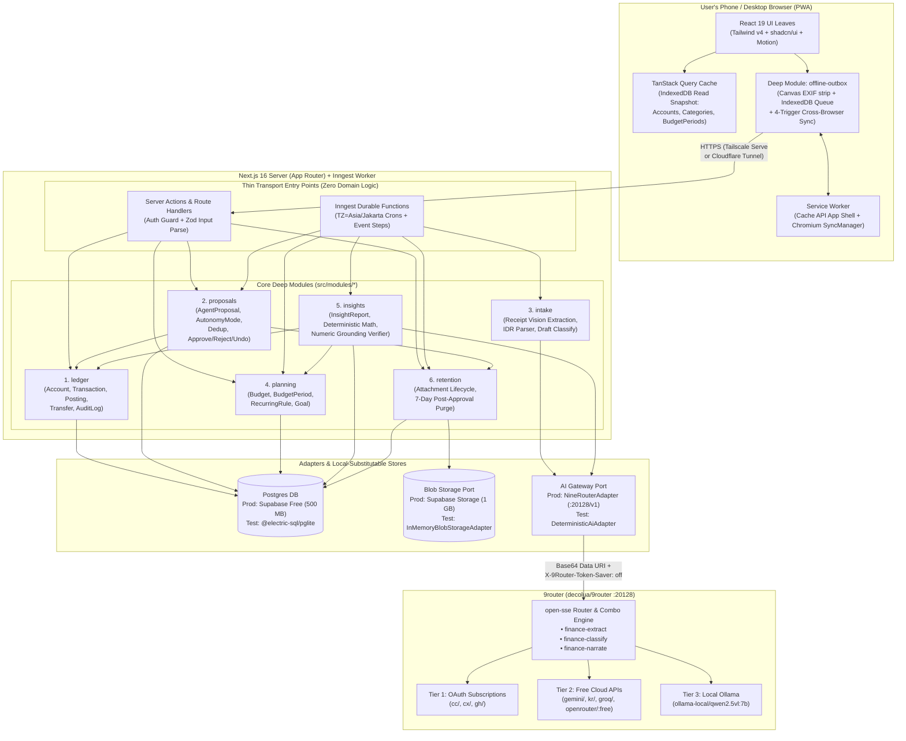
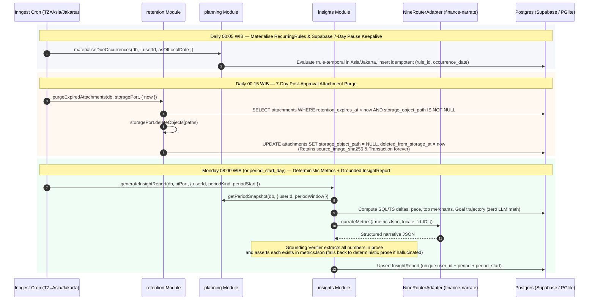
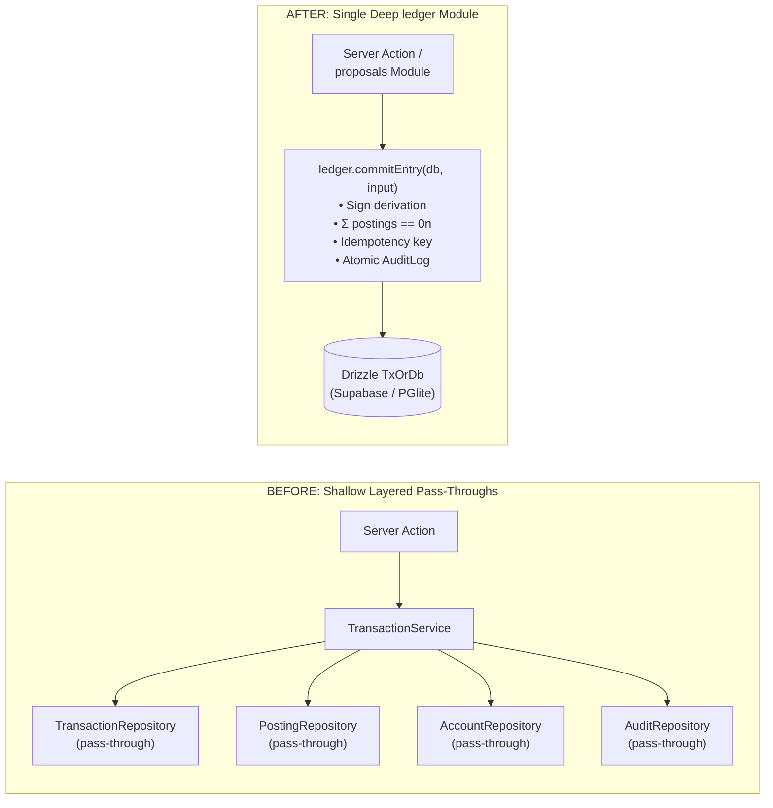
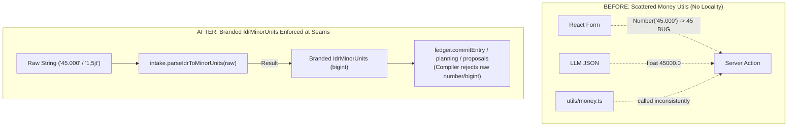
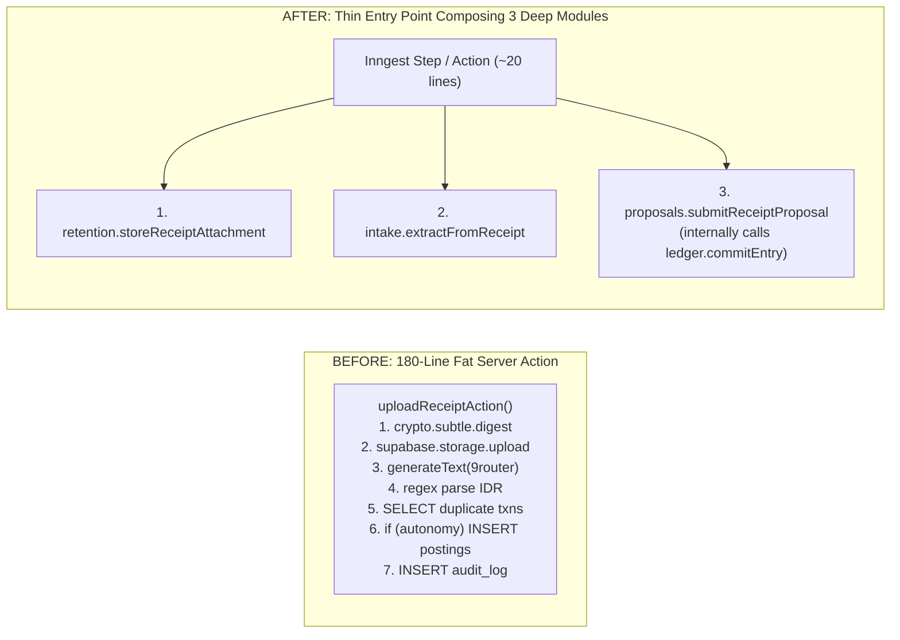
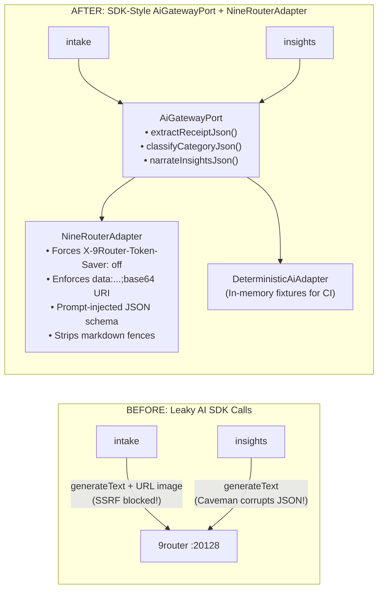

# Architecture, System Design & Deep-Module Specification: Agentic Personal Financial Tracker

> Authored 2026-10-26 (UTC+7). Companion specification to [`docs/research/agentic-financial-tracker.md`](./agentic-financial-tracker.md).
> Package versions verified against `registry.npmjs.org/<pkg>/latest` on 2026-10-26 (`next` 16.4.3, `react` 19.3.1, `ai` 7.0.153, `@ai-sdk/openai-compatible` 3.0.78, `9router` 0.5.111, `drizzle-orm` 0.45.4, `@electric-sql/pglite` 0.5.11, `inngest` 4.26.0, `rrule-temporal` 2.2.8, `temporal-polyfill` 1.0.6, `zod` 4.6.7, `vitest` 5.0.5, `fake-indexeddb` 6.2.6, `eslint-plugin-boundaries` 7.3.0).
> Architectural terminology strictly follows the **Deep-Module Design Vocabulary** (`Module`, `Interface`, `Implementation`, `Depth`, `Seam`, `Adapter`, `Leverage`, `Locality`), and domain terminology strictly follows the **Domain Glossary** (`Account`, `Category`, `Transaction`, `Posting`, `Transfer`, `Budget`, `BudgetPeriod`, `RecurringRule`, `Occurrence`, `Goal`, `AgentProposal`, `AutonomyMode`, `Attachment`, `InsightReport`, `AuditLog`, `Combo`, `IdrMinorUnits`).

---

## 1. Architectural Philosophy & Deep-Module Vocabulary

### 1.1 Governing Vocabulary

To prevent architectural drift across human and AI contributors, this codebase enforces a strict, unambiguous vocabulary (adapted from John Ousterhout's *A Philosophy of Software Design*, 2nd ed., 2021, and Michael Feathers' *Working Effectively with Legacy Code*, 2004, refined with leverage-based depth):

| Term | Exact Definition in This Codebase | Terms We Avoid (and Why) |
|---|---|---|
| **Module** | Anything with an **interface** and an **implementation**. Scale-agnostic: a function, a directory slice (`src/modules/ledger`), or a client-side sync engine (`src/modules/offline-outbox`). | *"Service"*, *"Component"* (reserved strictly for React UI leaf nodes), *"Unit"*. |
| **Interface** | Everything a caller must know to use a **module** correctly: TypeScript types and function signatures, **plus** domain invariants, ordering constraints, error union modes, required configuration, and performance characteristics. | *"API"* (reserved for HTTP endpoints), *"Signature"* (too narrow; ignores invariants and error modes). |
| **Implementation** | The body of code hidden inside a **module** behind its **seam**. | – |
| **Depth** | **Leverage at the interface**: the amount of domain behaviour and invariant enforcement a caller (or test) exercises per unit of **interface** they must learn. A **deep module** hides substantial complexity behind a small interface; a **shallow module** has an interface nearly as complex as its implementation. (Note: we reject measuring depth as lines-of-implementation ÷ lines-of-interface, which rewards code padding.) | – |
| **Seam** | A place where you can alter behaviour without editing in that place (Feathers, 2004); the exact location (`src/modules/<name>/index.ts` or an injected port) where a **module**'s **interface** lives. | *"Boundary"* (overloaded with DDD Bounded Contexts). |
| **Adapter** | A concrete implementation that satisfies an **interface** (port) at a **seam**. Describes *role* at the seam (e.g., `NineRouterAdapter` vs. `DeterministicAiAdapter`), not size. | *"Wrapper"*, *"Provider"* (when referring to our own seam implementations). |
| **Leverage** | What callers gain from **depth**: more guaranteed capability per unit of **interface** learned, paying back across $N$ entry points and $M$ tests. | – |
| **Locality** | What maintainers gain from **depth**: domain rules, bugs, schema invariants, and verification concentrate inside one **module** rather than scattering across callers. Fix once, fixed everywhere. | – |

```
DEEP MODULE (Target)                        SHALLOW MODULE (Rejected)
┌───────────────────────────┐               ┌───────────────────────────────────────────┐
│      Small Interface      │               │       Large / Chatty Interface            │
│  (3–4 functions, branded  │               │ (15 CRUD methods, caller computes signs,  │
│   types, clear invariants)│               │  caller passes raw numbers & timestamps)  │
├───────────────────────────┤               ├───────────────────────────────────────────┤
│                           │               │       Thin Pass-Through Implementation    │
│    Deep Implementation    │               └───────────────────────────────────────────┘
│  (Double-entry math,      │
│   idempotency, dedup,     │
│   IDR parsing, audit log, │
│   SQL transactions)       │
└───────────────────────────┘
```

### 1.2 The Four Core Design Principles

1. **Depth is a property of the interface, not the implementation.** A deep module may be internally decomposed into smaller files (`internal/parser.ts`, `internal/dedup.ts`, `internal/schema.ts`), provided those files are never exported past the module's external **seam** (`index.ts`).
2. **The Deletion Test.** Imagine deleting a module and inlining its code into its callers. If total complexity *vanishes*, the module was a shallow pass-through (e.g., a `TransactionRepository` that just wraps `db.insert(transactions)`). If complexity *explodes across $N$ callers* (every caller now having to compute double-entry signs, verify $\sum \text{postings} = 0$, check `idempotency_key`, and write an `AuditLog`), the module is deep and earning its keep.
3. **The Interface is the Test Surface.** Production callers and automated tests cross the exact same **seam** (`src/modules/<name>/index.ts`). We never reach inside `internal/` to unit-test private helpers, and we never assert on database rows via a back-channel `SELECT` when the module's own read interface can observe the outcome.
4. **One Adapter = Hypothetical Seam; Two Adapters = Real Seam.** We never introduce an injected port interface (`IMyRepository`) unless at least two concrete **adapters** exist (typically one production adapter and one fast, deterministic test adapter) because the dependency cannot run in-process during tests.

### 1.3 Dependency Categories & Seam Map for Our Stack

Every dependency in the financial tracker is classified into one of four categories, which dictates whether it lives **inside** a module (tested via an in-process stand-in) or crosses an **external injected seam** (Ports & Adapters):

| Category | Definition | Stack Dependencies in This Category | Seam & Testing Strategy |
|---|---|---|---|
| **1. In-process** | Pure computation, in-memory state, zero I/O. | IDR money arithmetic (`IdrMinorUnits`), double-entry sign derivation, RRULE evaluation ([`rrule-temporal` 2.2.8](https://github.com/ggaabe/rrule-temporal) + [`temporal-polyfill` 1.0.6](https://github.com/fullcalendar/temporal-polyfill)), Indonesian receipt string parsing, numeric grounding verification. | **Merged directly inside deep modules.** Zero adapters or mocks; tested through the owning module's interface. |
| **2. Local-substitutable** | Stateful/I/O dependencies that have an exact, fast in-process stand-in for tests. | **PostgreSQL** via [**PGlite** (`@electric-sql/pglite` 0.5.11)](https://pglite.dev/docs/) + [`drizzle-orm/pglite`](https://orm.drizzle.team/docs/get-started-postgresql#pglite); **Browser IndexedDB** via [`fake-indexeddb` 6.2.6](https://github.com/dumbmatter/fakeIndexedDB). | **Internal seam only (`DbClient` / `IDBFactory`).** We do **not** create `ITransactionRepository` or `IBudgetRepository` ports! Deep modules accept a Drizzle `TxOrDb` handle (`PgDatabase`) directly. Production passes the Supabase connection pool; Vitest passes an in-memory PGlite instance running the real Drizzle SQL migrations, `CHECK` constraints, and triggers in <50 ms. |
| **3. Remote but owned** | Services we operate across a network hop. | **9router** (`decolua/9router` `0.5.111` on `:20128/v1`, [GitHub](https://github.com/decolua/9router)); **Next.js API transport** called by the PWA offline outbox (`OutboxTransportPort`). | **Injected Port at the module seam (`AiGatewayPort`, `OutboxTransportPort`).** Two real adapters per port: `NineRouterAdapter` (HTTP via `@ai-sdk/openai-compatible`) + `DeterministicAiAdapter` (in-memory test double); `FetchOutboxTransportAdapter` + `InMemoryOutboxTransportAdapter`. |
| **4. True external** | Third-party cloud infrastructure outside our process control. | **Supabase Storage** (private `receipts` bucket, [Supabase Storage ACL](https://supabase.com/docs/guides/storage/security/access-control)); **Web Push notification delivery**. | **Injected Port at the module seam (`BlobStoragePort`).** Two real adapters: `SupabaseBlobStorageAdapter` (prod) + `InMemoryBlobStorageAdapter` (tests). |

---

## 2. High-Level System Design & Runtime Topology

### 2.1 System Context & Deployment Topology ($0/mo Single-User Stack)



**Separation of concerns between Entry Points and Deep Modules:**
- **Transport Entry Points (`src/app/actions/*`, `src/app/api/*`, `src/inngest/functions/*`):** Must remain under ~30 lines each. Their *only* job is to authenticate the single user (`requireSingleUserAuth()`), parse untrusted HTTP/form data, inject the production `db` and port adapters (`nineRouterAdapter`, `supabaseBlobStorageAdapter`), call **one** deep module method (or compose a workflow step), and revalidate Next.js caches (`revalidatePath`).
- **Deep Modules (`src/modules/*`):** Framework-agnostic TypeScript modules. They never import `next/headers`, `next/cache`, or `inngest`. They can be invoked identically from a Next.js Server Action, an Inngest background step, a CLI script, or a Vitest test suite.

### 2.2 Sequence 1: Offline Receipt Capture → Online Flush → Vision Intake → Proposal Gate → Ledger Commit

```mermaid
sequenceDiagram
    autonumber
    participant User as User (Mobile PWA)
    participant Outbox as offline-outbox Module (IndexedDB)
    participant API as Next.js Route /api/outbox/flush
    participant Ret as retention Module
    participant Inngest as Inngest Worker
    participant Intake as intake Module
    participant R9 as NineRouterAdapter (:20128/v1)
    participant Prop as proposals Module
    participant Led as ledger Module

    User->>Outbox: enqueueReceipt({ file, accountHintId, capturedAt })
    Note over Outbox: Redraw to Canvas (≤2000px JPEG 0.8, strip EXIF/GPS),<br/>compute sha256, assign client_id (UUIDv7), store Blob in IndexedDB
    Outbox-->>User: Optimistic "Queued Offline" badge

    Note over Outbox,API: Connectivity returns (SyncManager / window 'online' / iOS 'visibilitychange')
    Outbox->>API: POST /api/outbox/flush (multipart + client_id)
    API->>Ret: storeReceiptAttachment(db, storagePort, { userId, bytes, mime, clientId })
    Note over Ret: Check unique (user_id, source_image_sha256).<br/>Upload private object, insert Attachment(retention_expires_at = null)
    Ret-->>API: Ok({ attachment, isDuplicateImage: false })
    API->>Inngest: send("attachment/uploaded", { attachmentId, userId })
    API-->>Outbox: 200 OK (remove from IndexedDB outbox)

    Inngest->>Ret: step 1: readAttachmentBytes(db, storagePort, attachmentId)
    Inngest->>Intake: step 2: extractFromReceipt(aiPort, { imageBytes, mime, accounts, categories, tzid })
    Note over Intake,R9: Encode Uint8Array -> data:image/jpeg;base64,... (avoids 9router SSRF block)<br/>Send X-9Router-Token-Saver: off, parse IDR strings to IdrMinorUnits,<br/>cross-check subtotal + tax - discount == total
    R9-->>Intake: Validated ReceiptExtraction + modelId
    Inngest->>Prop: step 3: submitReceiptProposal(db, { userId, attachmentId, extraction })
    Note over Prop: Check semantic dedup (Account + amount_minor + date±1 + merchant).<br/>Evaluate AutonomyMode (default: propose_only -> status='pending')
    alt AutonomyMode == 'auto_if_confident' AND confidence >= 0.9 AND amount <= cap AND !hasSemanticDup
        Prop->>Led: commitEntry(tx, { ... })
        Prop->>Ret: markAttachmentApproved(tx, { attachmentId, approvedAt: now() })
        Note over Ret: Sets retention_expires_at = now() + 7 days
        Prop-->>User: Push/Toast: "Posted Rp45.000 at Indomaret — Undo"
    else Default ('propose_only') or requires review
        Prop-->>User: AgentProposal(pending) card in Inbox
        User->>Prop: decideProposal(db, { proposalId, decision: 'approve', edits })
        Prop->>Led: commitEntry(tx, { ... })
        Prop->>Ret: markAttachmentApproved(tx, { attachmentId, approvedAt: now() })
    end
```

### 2.3 Sequence 2: Scheduled Weekly/Monthly Insight Generation & Daily 7-Day Attachment Purge



---

## 3. The Deep Modules Catalogue (Interfaces, Invariants, Seams & Implementations)

Instead of horizontal layers (`controllers/`, `services/`, `repositories/`, `validators/`, `mappers/`), the entire application is built from **seven deep modules**: six server/shared domain modules (`ledger`, `proposals`, `intake`, `planning`, `insights`, `retention`) and one client-side browser module (`offline-outbox`).

### Summary Matrix of the 7 Deep Modules

| Module Path | Domain Terms Owned | Dependency Category | External Seam (`index.ts`) Entry Points | Key Complexity Hidden Inside Implementation |
|---|---|---|---|---|
| `src/modules/ledger` | `Account`, `Category`, `Transaction`, `Posting`, `Transfer`, `AuditLog`, `IdrMinorUnits` | **Cat 1 + Cat 2** (Postgres via PGlite in tests; no repo port) | `commitEntry`, `reverseEntry`, `upsertAccount`, `upsertCategory`, `getAccountBalances`, `listLedgerActivity` | Double-entry leg generation, $\sum \text{postings} = 0$ check, `idempotency_key` dedup, atomic `AuditLog` write, exclude `Transfer`s from spend totals. |
| `src/modules/proposals` | `AgentProposal`, `AutonomyMode` | **Cat 2** (Composes `ledger` + `retention` in one DB tx) | `submitReceiptProposal`, `decideProposal`, `revertAppliedProposal`, `listProposals` | SHA-256 & semantic dedup (`Account` + `amount_minor` + `date±1` + fuzzy merchant), `AutonomyMode` gate ($\tau \ge 0.9$, category cap), `link_transfer` merge, 1-tap Undo. |
| `src/modules/intake` | `Combo` (via `AiGatewayPort`), Receipt extraction & draft classification | **Cat 1 + Cat 3/4** (`AiGatewayPort`: `NineRouterAdapter` / `DeterministicAiAdapter`) | `extractFromReceipt`, `classifyTransactionDraft`, `parseIdrToMinorUnits` | Base64 `Uint8Array` data-URI encoding (SSRF bypass), `X-9Router-Token-Saver: off`, prompt-injected JSON schema, IDR string parser (`45.000` / `1,5jt`), arithmetic cross-check (`subtotal + tax - discount == total`). |
| `src/modules/planning` | `Budget`, `BudgetPeriod`, `RecurringRule`, `Occurrence`, `Goal` | **Cat 1 + Cat 2** (`rrule-temporal` + PGlite) | `resolveBudgetPeriod`, `getBudgetStatuses`, `materialiseDueOccurrences`, `getGoalProgress` | Payday cycle windowing (`period_start_day` `1..28` or `-1`), `RFC 5545` short-month rules in `Asia/Jakarta`, pace/burn-rate math, Goal bottleneck ranking. |
| `src/modules/insights` | `InsightReport` | **Cat 2 + Cat 3/4** (`DbClient` + `AiGatewayPort`) | `generateInsightReport`, `getInsightReports` | Deterministic SQL/TS metric aggregation, LLM narrative prompting, and **post-generation numeric grounding verification** (rejecting hallucinated numbers). |
| `src/modules/retention` | `Attachment` | **Cat 2 + Cat 4** (`DbClient` + `BlobStoragePort`) | `storeReceiptAttachment`, `readAttachmentBytes`, `markAttachmentApproved`, `purgeExpiredAttachments` | SHA-256 computation, private bucket storage, setting `retention_expires_at = approved_at + 7d`, deleting storage blobs after 7 days while keeping `source_image_sha256` forever. |
| `src/modules/offline-outbox` | Client outbox (`outbox_receipts`, `outbox_transactions`) | **Cat 2 + Cat 3** (`IDBFactory` via `fake-indexeddb` + `OutboxTransportPort`) | `enqueueReceiptCapture`, `enqueueManualTransaction`, `flushOutbox`, `subscribeOutboxState` | Canvas ≤2000px JPEG compression & EXIF/GPS stripping, UUIDv7 idempotency keys, IndexedDB persistence, 4-trigger sync (`SyncManager` + `online` + `visibilitychange` + manual). |

---

### 3.1 Module 1: `ledger` (Double-Entry Accounting & Audit Trail)

- **Role & Domain Terms Owned:** Single source of truth for money movement. Owns `Account`, `Category`, `Transaction`, `Posting`, `Transfer`, `AuditLog`, and `IdrMinorUnits`.
- **Dependency Category & Seam Placement:** **Category 2 (Local-substitutable Postgres).** Callers pass a Drizzle `TxOrDb` handle ([Drizzle Transactions](https://orm.drizzle.team/docs/transactions)). There is **no** `ITransactionRepository` or `IPostingRepository` port because `@electric-sql/pglite` runs real Postgres in-process during tests.

#### "Design It Twice" Comparison for `ledger`

| Design Option | Shape of Interface | Critique (Depth, Locality, Seam) |
|---|---|---|
| **Design A (Shallow CRUD / Ledger Primitive Surface — Rejected)** | `createTransactionRow(tx, row)`, `insertPostings(tx, postings[])`, `validateZeroSum(postings[])`, `appendAuditLog(tx, event)`, `getAccountBalance(db, accountId)` | **Fails the Deletion Test.** Every caller (manual form Server Action, `proposals` auto-apply, `planning` recurring materialiser) must know how to construct signed debit/credit `Posting` legs for an Expense vs. an Income vs. a Transfer with a fee, check $\sum \text{postings} = 0$, and remember to write an `AuditLog`. Bugs in sign direction or missing audit logs scatter across callers (**zero locality**). |
| **Design B (Over-Specialized Per-Action Methods — Rejected)** | `recordCashExpense(...)`, `recordBankIncome(...)`, `recordEwalletTopupWithFee(...)`, `recordRecurringExpense(...)`, `adjustAccountBalance(...)` | High caller convenience for known cases, but rigid: adding a split expense or a new source (`import`) multiplies top-level functions even though all of them obey the exact same double-entry invariant. |
| **Design C (Intent-Based Discriminated Union Entry — ⭐ Selected)** | `commitEntry(txOrDb, LedgerEntryInput)` where `LedgerEntryInput` is a discriminated union (`kind: 'expense' \| 'income' \| 'transfer' \| 'split'`) + `reverseEntry(txOrDb, input)` + `getAccountBalances` + `listLedgerActivity` | **Maximum Depth & Leverage.** Callers express *domain intent* using positive `IdrMinorUnits` (`{ kind: 'transfer', fromAccountId, toAccountId, amountMinor, feeMinor?, feeCategoryId? }`). The `ledger` module hides sign assignment, 2-leg vs. 3-leg `Posting` construction, $\sum \text{postings} = 0$ assertion, `idempotencyKey` conflict handling, and `AuditLog` recording inside one atomic SQL transaction. |

#### Full TypeScript Interface (`src/modules/ledger/index.ts`)

```ts
import type { PgDatabase, PgTransaction } from 'drizzle-orm/pg-core';

// Branded primitive types (see §6.1)
export type IdrMinorUnits = bigint & { readonly __brand: unique symbol };
export type UserId = string & { readonly __brand: 'UserId' };
export type AccountId = string & { readonly __brand: 'AccountId' };
export type CategoryId = string & { readonly __brand: 'CategoryId' };
export type TransactionId = string & { readonly __brand: 'TransactionId' };
export type IsoDateJakarta = string & { readonly __brand: 'IsoDateJakarta' }; // YYYY-MM-DD in Asia/Jakarta
export type Sha256Hex = string & { readonly __brand: 'Sha256Hex' };

export type TxOrDb = PgDatabase<any, any, any> | PgTransaction<any, any, any>;

export type LedgerEntrySpec =
  | {
      kind: 'expense';
      accountId: AccountId;
      categoryId: CategoryId;
      /** Strictly positive (> 0n). Module creates -amount on Account, +amount on Category. */
      amountMinor: IdrMinorUnits;
    }
  | {
      kind: 'income';
      accountId: AccountId;
      categoryId: CategoryId;
      /** Strictly positive (> 0n). Module creates +amount on Account, -amount on Category. */
      amountMinor: IdrMinorUnits;
    }
  | {
      kind: 'transfer';
      fromAccountId: AccountId;
      toAccountId: AccountId;
      /** Strictly positive (> 0n). Module creates -(amount + fee) on fromAccount, +amount on toAccount, +fee on feeCategory. */
      amountMinor: IdrMinorUnits;
      feeMinor?: IdrMinorUnits;
      feeCategoryId?: CategoryId;
    }
  | {
      kind: 'split_expense';
      accountId: AccountId;
      splits: ReadonlyArray<{ categoryId: CategoryId; amountMinor: IdrMinorUnits; memo?: string }>;
    };

export interface CommitEntryInput {
  userId: UserId;
  idempotencyKey: string; // e.g. client_id, proposal_id, or "rule:{id}:{date}"
  occurredAt: Date;
  localDate: IsoDateJakarta;
  merchant?: string;
  description?: string;
  source: 'manual' | 'agent' | 'recurring' | 'import';
  actor: 'user' | 'agent' | 'system';
  attachmentId?: string;
  sourceImageSha256?: Sha256Hex;
  recurringRuleId?: string;
  proposalId?: string;
  entry: LedgerEntrySpec;
}

export type LedgerError =
  | { code: 'NON_POSITIVE_AMOUNT'; message: string }
  | { code: 'SAME_ACCOUNT_TRANSFER'; accountId: AccountId }
  | { code: 'MISSING_FEE_CATEGORY'; feeMinor: IdrMinorUnits }
  | { code: 'ACCOUNT_NOT_FOUND_OR_ARCHIVED'; accountId: AccountId }
  | { code: 'CATEGORY_KIND_MISMATCH'; categoryId: CategoryId; expectedKind: 'expense' | 'income' }
  | { code: 'ALREADY_VOIDED'; transactionId: TransactionId };

export type Result<T, E> = { ok: true; value: T } | { ok: false; error: E };

export interface CommittedTransaction {
  id: TransactionId;
  status: 'posted';
  idempotentReplay: boolean;
  postings: ReadonlyArray<{
    id: string;
    accountId: AccountId | null;
    categoryId: CategoryId | null;
    amountMinor: bigint; // Signed (+ or -)
    currency: 'IDR';
  }>;
}

/**
 * Invariants guaranteed by `commitEntry`:
 * 1. Idempotent: repeating an `idempotencyKey` for the same `userId` returns the existing
 *    `CommittedTransaction` with `idempotentReplay: true` without duplicating Postings or AuditLogs.
 * 2. Zero-sum: Σ postings.amountMinor === 0n across every committed Transaction.
 * 3. Category kind match: 'expense' / 'transfer' fee legs must reference an 'expense' Category;
 *    'income' legs must reference an 'income' Category.
 * 4. Atomic AuditLog: writes the Transaction, Postings, and AuditLog in a single SQL transaction.
 */
export function commitEntry(
  db: TxOrDb,
  input: CommitEntryInput,
): Promise<Result<CommittedTransaction, LedgerError>>;

/**
 * Voids an existing Transaction (used by manual delete and 1-tap AgentProposal Undo)
 * and writes an append-only AuditLog record in the same SQL transaction.
 */
export function reverseEntry(
  db: TxOrDb,
  input: {
    userId: UserId;
    transactionId: TransactionId;
    actor: 'user' | 'agent' | 'system';
    reason: string;
    proposalId?: string;
  },
): Promise<Result<{ transactionId: TransactionId; status: 'void' }, LedgerError>>;

export function getAccountBalances(
  db: TxOrDb,
  input: { userId: UserId; includeArchived?: boolean },
): Promise<ReadonlyArray<{
  accountId: AccountId;
  name: string;
  type: 'cash' | 'bank' | 'ewallet' | 'credit_card' | 'other';
  balanceMinor: IdrMinorUnits; // opening_balance_minor + Σ posted postings
}>>;
```

---

### 3.2 Module 2: `proposals` (Agent Proposal Gate, Autonomy & Deduplication)

- **Role & Domain Terms Owned:** Owns `AgentProposal` and `AutonomyMode` (`propose_only`, `auto_if_confident`, `auto_always`). Acts as the gatekeeper between untrusted AI extraction (`intake`) and the immutable double-entry ledger (`ledger`).
- **Dependency Category & Seam Placement:** **Category 2 (Local-substitutable Postgres).** Internally composes `ledger.commitEntry`, `ledger.reverseEntry`, and `retention.markAttachmentApproved` inside a single Drizzle database transaction (`db.transaction(...)`).

#### "Design It Twice" Comparison for `proposals`

| Design Option | Shape of Interface | Critique (Depth, Locality, Seam) |
|---|---|---|
| **Design A (Caller-Orchestrated Step Functions — Rejected)** | `findDuplicateReceipt(db, ...)` → `evaluateAutonomyPolicy(userConfig, proposal)` → `insertProposal(db, ...)` → caller conditionally calls `ledger.commitEntry(db, ...)` and `retention.setExpiry(db, ...)` | **Shallow & error-prone.** A caller (Inngest step or Server Action) can forget to run semantic deduplication, or commit the ledger entry without updating `AgentProposal.resulting_transaction_id` and `Attachment.retention_expires_at` in the same transaction. |
| **Design B (Lifecycle State Machine Behind Three Deep Entry Points — ⭐ Selected)** | `submitReceiptProposal(db, input)`, `decideProposal(db, input)`, `revertAppliedProposal(db, input)` | **High Depth & Locality.** Callers hand a validated `ReceiptExtraction` to `submitReceiptProposal`. Inside one database transaction, `proposals` checks semantic duplicates (`Account` + `amount_minor` + `local_date ± 1` + fuzzy merchant/reference ID), upgrades the proposal kind to `link_transfer` if a matching transfer screenshot/receipt already exists, evaluates `AutonomyMode` ($\tau = 0.9$ + per-category `auto_approve_cap_minor`), and if auto-approved, commits to `ledger` and starts the 7-day `Attachment` retention clock atomically. |

#### Full TypeScript Interface (`src/modules/proposals/index.ts`)

```ts
import type { TxOrDb, UserId, TransactionId, AccountId, CategoryId, IdrMinorUnits, IsoDateJakarta, Result } from '../ledger';
import type { ReceiptExtraction } from '../intake';

export type ProposalId = string & { readonly __brand: 'ProposalId' };
export type AutonomyMode = 'propose_only' | 'auto_if_confident' | 'auto_always';

export interface SubmitProposalInput {
  userId: UserId;
  attachmentId: string;
  extraction: ReceiptExtraction;
  modelId: string;
  promptVersion: string;
}

export interface ProposalOutcome {
  proposalId: ProposalId;
  kind: 'create_transaction' | 'link_transfer';
  status: 'pending' | 'auto_applied';
  matchedExistingTransactionId: TransactionId | null;
  resultingTransactionId: TransactionId | null;
  autoApplyBlockedReasons: ReadonlyArray<
    | 'AUTONOMY_PROPOSE_ONLY'
    | 'CONFIDENCE_BELOW_THRESHOLD'
    | 'EXCEEDS_CATEGORY_AUTO_CAP'
    | 'SEMANTIC_DUPLICATE_CANDIDATE'
    | 'UNRESOLVED_ACCOUNT_OR_CATEGORY'
  >;
}

export type ProposalError =
  | { code: 'PROPOSAL_NOT_FOUND'; proposalId: ProposalId }
  | { code: 'INVALID_STATUS_TRANSITION'; currentStatus: string; attemptedAction: string }
  | { code: 'LEDGER_COMMIT_FAILED'; detail: unknown };

/**
 * Invariants:
 * 1. Idempotent on `attachmentId`: re-running an Inngest step for the same `attachmentId`
 *    returns the existing `ProposalOutcome` without creating duplicate proposals or transactions.
 * 2. Semantic dedup: searches posted Transactions within `localDate ± 1 day` with identical
 *    `amountMinor` and matching `referenceId` or normalized merchant. If found, sets
 *    `kind = 'link_transfer'` and forces `status = 'pending'` (never auto-applies a potential duplicate).
 * 3. Autonomy gate: only auto-applies when `AutonomyMode !== 'propose_only'`,
 *    `overallConfidence >= 0.9` (for `auto_if_confident`), `amountMinor <= category.autoApproveCapMinor`,
 *    both `accountId` and `categoryId` resolved, and zero semantic duplicate candidates exist.
 * 4. Atomic 7-day retention trigger: whenever a proposal transitions to `approved`, `edited`,
 *    or `auto_applied`, calls `retention.markAttachmentApproved(tx)` in the same SQL transaction.
 */
export function submitReceiptProposal(
  db: TxOrDb,
  input: SubmitProposalInput,
): Promise<Result<ProposalOutcome, ProposalError>>;

export function decideProposal(
  db: TxOrDb,
  input: {
    userId: UserId;
    proposalId: ProposalId;
    decision: 'approve' | 'reject';
    overrides?: {
      type?: 'expense' | 'income' | 'transfer';
      accountId?: AccountId;
      toAccountId?: AccountId;
      categoryId?: CategoryId;
      amountMinor?: IdrMinorUnits;
      localDate?: IsoDateJakarta;
      merchant?: string;
    };
  },
): Promise<Result<{ proposalId: ProposalId; status: 'approved' | 'edited' | 'rejected'; resultingTransactionId: TransactionId | null }, ProposalError>>;

/** 1-tap Undo for `auto_applied` or `approved` proposals: voids the Transaction via `ledger.reverseEntry`. */
export function revertAppliedProposal(
  db: TxOrDb,
  input: { userId: UserId; proposalId: ProposalId; reason?: string },
): Promise<Result<{ proposalId: ProposalId; voidedTransactionId: TransactionId }, ProposalError>>;
```

---

### 3.3 Module 3: `intake` (9router Vision Extraction, IDR Parser & Draft Classification)

- **Role & Domain Terms Owned:** Turns raw receipt/screenshot bytes or free-text merchant descriptions into validated, IDR-normalized domain structures (`ReceiptExtraction`, `CategoryClassification`).
- **Dependency Category & Seam Placement:** **Category 1 (In-process IDR parsing & arithmetic cross-checks) + Category 3/4 (`AiGatewayPort` injected seam).**
  - Why `AiGatewayPort` is a **real seam** with two adapters:
    1. `NineRouterAdapter` (`src/adapters/ai-ninerouter/index.ts`): Uses `@ai-sdk/openai-compatible` (`3.0.78`) pointed at `NINEROUTER_BASE_URL` (`http://127.0.0.1:20128/v1`), sets `'X-9Router-Token-Saver': 'off'` ([`decolua/9router` README #L556](https://github.com/decolua/9router/blob/master/README.md#L556)), encodes `Uint8Array` image bytes as `data:image/jpeg;base64,...` data URIs so 9router's `open-sse/translator/concerns/image.js` (`parseDataUri`) processes them inline without tripping `fetchImageAsBase64`'s private-IP/Tailscale SSRF blocker, and uses prompt-injected JSON schema validation so Combos work across Claude (`cc/`), Gemini (`gemini/`), Kiro (`kr/`), and local Ollama (`ollama-local/`).
    2. `DeterministicAiAdapter` (`src/adapters/ai-deterministic/index.ts`): Returns canned or fixture-keyed model responses in <1 ms for Vitest suites.

#### Full TypeScript Interface (`src/modules/intake/index.ts`)

```ts
import type { AccountId, CategoryId, IdrMinorUnits, IsoDateJakarta, Result } from '../ledger';

export interface AiGatewayPort {
  extractReceiptJson(input: {
    imageDataUri: `data:${string};base64,${string}`;
    systemPrompt: string;
    userPrompt: string;
  }): Promise<{ rawJson: unknown; modelId: string }>;

  classifyCategoryJson(input: {
    merchant: string;
    description?: string;
    categories: ReadonlyArray<{ id: string; name: string; kind: 'expense' | 'income' }>;
  }): Promise<{ categoryId: string; confidence: number; modelId: string }>;

  narrateInsightsJson(input: {
    metricsJson: Record<string, unknown>;
    locale: 'id-ID' | 'en-US';
  }): Promise<{ rawJson: unknown; modelId: string }>;
}

export interface ReceiptExtraction {
  docType: 'receipt' | 'transfer' | 'notification' | 'other';
  merchant: string;
  occurredAtLocalDate: IsoDateJakarta;
  currency: 'IDR';
  totalMinor: IdrMinorUnits;
  subtotalMinor: IdrMinorUnits | null;
  taxMinor: IdrMinorUnits | null;
  serviceChargeMinor: IdrMinorUnits | null;
  discountMinor: IdrMinorUnits | null;
  feeMinor: IdrMinorUnits | null;
  lineItems: ReadonlyArray<{
    name: string;
    qty: number;
    unitPriceMinor: IdrMinorUnits;
    lineTotalMinor: IdrMinorUnits;
  }>;
  resolvedAccountId: AccountId | null;
  resolvedToAccountId: AccountId | null;
  resolvedCategoryId: CategoryId | null;
  isTransferBetweenOwnAccounts: boolean;
  referenceId: string | null;
  overallConfidence: number; // Calibrated: min(llmConfidence, deterministicCheckScore)
  arithmeticCheckPassed: boolean;
  warnings: ReadonlyArray<string>;
}

export type IntakeError =
  | { code: 'IMAGE_TOO_LARGE_OR_INVALID_MAGIC_BYTES'; byteLength: number }
  | { code: 'UNPARSEABLE_IDR_AMOUNT'; rawValue: string; field: string }
  | { code: 'SCHEMA_VALIDATION_FAILED'; issues: ReadonlyArray<string> }
  | { code: 'AI_GATEWAY_UNAVAILABLE'; cause: string };

/**
 * Hides:
 * 1. Magic-byte verification (JPEG/PNG/WebP) and base64 data-URI encoding.
 * 2. Zero-tool prompt-injection isolation (OWASP LLM01:2025).
 * 3. `parseIdrToMinorUnits` on all raw string amounts ("Rp 45.000", "45.000,00", "45rb", "1,5jt").
 * 4. Deterministic arithmetic cross-check: verifies `subtotal + tax + service - discount == total`
 *    and `Σ lineItems == subtotal`. If mismatched, sets `arithmeticCheckPassed = false` and caps
 *    `overallConfidence <= 0.65` so `proposals` will NEVER auto-apply it.
 */
export function extractFromReceipt(
  aiGateway: AiGatewayPort,
  input: {
    imageBytes: Uint8Array;
    mimeType: 'image/jpeg' | 'image/png' | 'image/webp';
    uploadedAt: Date;
    tzid: string; // 'Asia/Jakarta'
    userAccounts: ReadonlyArray<{ id: AccountId; name: string; provider?: string }>;
    userCategories: ReadonlyArray<{ id: CategoryId; name: string; kind: 'expense' | 'income' }>;
  },
): Promise<Result<{ extraction: ReceiptExtraction; modelId: string }, IntakeError>>;

/**
 * Deterministic Indonesian IDR string parser.
 * Accepts "Rp 45.000", "45.000", "45.000,00", "45k", "45rb", "1,5jt".
 * Rejects ambiguous English decimals like "45.50" (2 digits after dot) with UNPARSEABLE_IDR_AMOUNT.
 */
export function parseIdrToMinorUnits(raw: string): Result<IdrMinorUnits, IntakeError>;
```

---

### 3.4 Module 4: `planning` (Budgets, Payday Cycles, Recurrence & Goals)

- **Role & Domain Terms Owned:** Owns forward-looking financial structure: `Budget`, `BudgetPeriod`, `RecurringRule`, `Occurrence`, and `Goal`.
- **Dependency Category & Seam Placement:** **Category 1 (`rrule-temporal` + `temporal-polyfill` date math) + Category 2 (`TxOrDb` Postgres).**
- **What the Implementation Hides:**
  - **Payday-aligned `BudgetPeriod` calculation:** Given `period_start_day` (`1..28` or `-1` for last day of month) and a reference `IsoDateJakarta`, computes the exact `[startDate, endDate]` window using `Temporal.PlainDate` (e.g., if `period_start_day = 25` and today is `2026-10-26`, the active `BudgetPeriod` is `2026-10-25` through `2026-11-24`).
  - **Budget pace & alert thresholds:** Sums posted expense `Posting`s (strictly excluding `Transfer`s and voided transactions), computes `percentUsed`, `percentPeriodElapsed`, `paceRatio = percentUsed / percentPeriodElapsed`, `projectedEndMinor`, and which `alert_thresholds` (`80`, `100`) have been crossed.
  - **RFC 5545 `RecurringRule` evaluation:** Evaluates `rrule` strings in `Asia/Jakarta` via [`rrule-temporal` 2.2.8](https://github.com/ggaabe/rrule-temporal), handling short-month rules (`BYMONTHDAY=-1`) and idempotently materialising `Occurrence`s via unique `(rule_id, occurrence_date)` into `ledger.commitEntry` (when `mode = 'auto_post'`) or pending transactions (`mode = 'confirm'`).
  - **Deterministic `Goal` trajectory & bottleneck ranking:** Computes `remainingMinor`, `monthsLeft`, `requiredMonthlyMinor`, trailing 3-period average contribution, `onTrack` boolean, and ranks overspent `Budget` categories by how much of the monthly `Goal` shortfall they would close if brought back to budget.

```ts
// src/modules/planning/index.ts
export interface BudgetPeriodWindow {
  startDate: IsoDateJakarta; // Inclusive
  endDate: IsoDateJakarta;   // Inclusive
  totalDays: number;
  elapsedDays: number;
}

export function resolveBudgetPeriod(input: {
  asOfDate: IsoDateJakarta;
  periodStartDay: number; // 1..28 or -1 (last day of month)
}): BudgetPeriodWindow;

export function getBudgetStatuses(
  db: TxOrDb,
  input: { userId: UserId; asOfDate: IsoDateJakarta },
): Promise<ReadonlyArray<{
  budgetId: string;
  categoryId: CategoryId;
  categoryName: string;
  period: BudgetPeriodWindow;
  limitMinor: IdrMinorUnits;
  spentMinor: IdrMinorUnits;
  remainingMinor: bigint;
  percentUsed: number;
  paceRatio: number;
  triggeredThresholds: ReadonlyArray<number>;
}>>;

export function materialiseDueOccurrences(
  db: TxOrDb,
  input: { userId: UserId; throughDate: IsoDateJakarta },
): Promise<{ materialisedCount: number; transactionIds: ReadonlyArray<TransactionId> }>;

export function getGoalProgress(
  db: TxOrDb,
  input: { userId: UserId; asOfDate: IsoDateJakarta },
): Promise<ReadonlyArray<{
  goalId: string;
  name: string;
  targetMinor: IdrMinorUnits;
  currentMinor: IdrMinorUnits;
  requiredMonthlyMinor: IdrMinorUnits;
  trailingAvgMonthlyContributionMinor: bigint;
  projectedCompletionDate: IsoDateJakarta | null;
  onTrack: boolean;
  topBottleneckCategories: ReadonlyArray<{ categoryId: CategoryId; overspendMinor: IdrMinorUnits }>;
}>>;
```

---

### 3.5 Module 5: `insights` (Deterministic Analytics & Grounded Narrative)

- **Role & Domain Terms Owned:** Owns `InsightReport` (weekly Monday 08:00 WIB digest and period-end digest).
- **Dependency Category & Seam Placement:** **Category 2 (`TxOrDb`) + Category 3/4 (`AiGatewayPort`).**
- **What the Implementation Hides:**
  1. Computes 100% of numerical metrics in SQL/TypeScript (`metricsJson`: total income, total expense, net savings rate, period-over-period delta %, top 5 merchants, overspent `Budget`s, and `Goal` status from `planning`).
  2. Calls `aiGateway.narrateInsightsJson({ metricsJson, locale })` (`finance-narrate` Combo in 9router).
  3. **Post-generation Numeric Grounding Verifier (`verifyNarrativeGrounding`):** Parses every numeric token (`Rp 1.250.000`, `45%`, `1,25jt`, `3`) out of the LLM's returned `{ headline, wins[], warnings[], recommendations[] }` and checks that each number matches an entry in the deterministic `allowedNumbers` set derived from `metricsJson`. If the LLM hallucinates any number not in `metricsJson`, the implementation discards the LLM prose and substitutes a deterministic Indonesian/English template narrative so an ungrounded number can **never** be persisted or shown to the user.

```ts
// src/modules/insights/index.ts
export interface InsightReportRecord {
  id: string;
  periodKind: 'week' | 'budget_period';
  periodStart: IsoDateJakarta;
  periodEnd: IsoDateJakarta;
  metrics: Record<string, unknown>;
  narrative: {
    headline: string;
    wins: ReadonlyArray<string>;
    warnings: ReadonlyArray<string>;
    recommendations: ReadonlyArray<{ action: string; impactMetricKey: string }>;
  };
  groundingPassed: boolean;
  modelId: string;
  generatedAt: Date;
}

export function generateInsightReport(
  db: TxOrDb,
  aiGateway: AiGatewayPort,
  input: {
    userId: UserId;
    periodKind: 'week' | 'budget_period';
    asOfDate: IsoDateJakarta;
    locale?: 'id-ID' | 'en-US';
  },
): Promise<InsightReportRecord>;
```

---

### 3.6 Module 6: `retention` (Attachment Storage & 7-Day Post-Approval Purge)

- **Role & Domain Terms Owned:** Owns `Attachment` lifecycle across object storage and Postgres metadata, enforcing the locked **7-day post-approval retention policy** (`agentic-financial-tracker.md` §6.3, §12 #10).
- **Dependency Category & Seam Placement:** **Category 2 (`TxOrDb`) + Category 4 (`BlobStoragePort`: `SupabaseBlobStorageAdapter` in prod, `InMemoryBlobStorageAdapter` in tests).**
- **What the Implementation Hides:**
  - Computes `source_image_sha256` over the uploaded bytes and checks `(user_id, source_image_sha256)` in `attachments`. Crucially, because `source_image_sha256` is kept in Postgres even after the image blob is purged from Supabase Storage after 7 days, re-uploading an old screenshot months later is **still caught immediately as a duplicate image** without needing the original file!
  - `markAttachmentApproved(tx, { attachmentId, approvedAt })`: sets `approved_at = approvedAt` and `retention_expires_at = approvedAt + interval '7 days'`.
  - `purgeExpiredAttachments(db, storagePort, { now })`: selects rows where `retention_expires_at <= now AND storage_object_path IS NOT NULL`, deletes the objects via `storagePort.deleteObjects(paths)`, and updates `storage_object_path = null, deleted_from_storage_at = now`.

```ts
// src/modules/retention/index.ts
export interface BlobStoragePort {
  putObject(input: { path: string; bytes: Uint8Array; mimeType: string }): Promise<void>;
  getObjectBytes(path: string): Promise<Uint8Array | null>;
  createSignedPreviewUrl(path: string, expiresInSeconds: number): Promise<string>;
  deleteObjects(paths: ReadonlyArray<string>): Promise<void>;
}

export function storeReceiptAttachment(
  db: TxOrDb,
  storage: BlobStoragePort,
  input: {
    userId: UserId;
    bytes: Uint8Array;
    mimeType: 'image/jpeg' | 'image/png' | 'image/webp';
    width?: number;
    height?: number;
  },
): Promise<{
  attachmentId: string;
  sourceImageSha256: Sha256Hex;
  isDuplicateImage: boolean;
}>;

export function markAttachmentApproved(
  db: TxOrDb,
  input: { attachmentId: string; approvedAt: Date },
): Promise<void>;

export function purgeExpiredAttachments(
  db: TxOrDb,
  storage: BlobStoragePort,
  input: { now: Date },
): Promise<{ purgedCount: number; purgedAttachmentIds: ReadonlyArray<string> }>;
```

---

### 3.7 Module 7: `offline-outbox` (Client-Side Offline Capture & Cross-Browser Sync)

- **Role & Domain Terms Owned:** Owns client-side offline capture (`outbox_receipts` and `outbox_transactions` in IndexedDB) and cross-browser queue flushing across Android Chrome and iOS Safari (`agentic-financial-tracker.md` §9.3).
- **Dependency Category & Seam Placement:** **Category 2 (`IDBFactory` tested via `fake-indexeddb` `6.2.6`) + Category 3 (`OutboxTransportPort` injected HTTP adapter).**
- **What the Implementation Hides:**
  - Client-side image preprocessing (`OffscreenCanvas` / `<canvas>` resize to ≤2000 px long edge, JPEG 0.8 compression, complete EXIF/GPS metadata removal).
  - UUIDv7 client idempotency key generation (`client_id`).
  - Cross-browser 4-trigger sync registration: (1) Chromium `ServiceWorkerRegistration.sync.register('flush-outbox')` when `'SyncManager' in window` ([MDN SyncManager BCD](https://github.com/mdn/browser-compat-data/blob/main/api/SyncManager.json)), (2) `window.addEventListener('online', ...)`, (3) iOS Safari foreground recovery via `document.addEventListener('visibilitychange', ...)` and `window.addEventListener('pageshow', ...)`, and (4) manual `flushOutbox()` trigger.

```ts
// src/modules/offline-outbox/index.ts
export interface OutboxTransportPort {
  uploadQueuedReceipt(item: {
    clientId: string;
    jpegBlob: Blob;
    capturedAtIso: string;
    accountHintId?: string;
    note?: string;
  }): Promise<{ ok: boolean; attachmentId?: string; retryable?: boolean }>;

  submitQueuedTransaction(item: {
    clientId: string;
    payload: Record<string, unknown>;
  }): Promise<{ ok: boolean; transactionId?: string; retryable?: boolean }>;
}

export interface OfflineOutbox {
  enqueueReceipt(input: { file: Blob; accountHintId?: string; note?: string; now?: Date }): Promise<{ clientId: string }>;
  enqueueManualTransaction(input: { payload: Record<string, unknown>; now?: Date }): Promise<{ clientId: string }>;
  flushOutbox(): Promise<{ flushedReceipts: number; flushedTransactions: number; remaining: number }>;
  getPendingSummary(): Promise<{ pendingReceipts: number; pendingTransactions: number }>;
  attachBrowserLifecycleListeners(win: Window, doc: Document): () => void;
}

export function createOfflineOutbox(deps: {
  idbFactory: IDBFactory;
  transport: OutboxTransportPort;
  imageCompressor?: (raw: Blob) => Promise<Blob>; // Defaults to Canvas <=2000px JPEG EXIF-stripper
}): OfflineOutbox;
```

---

## 4. Deepening Candidates ("Before vs. After" Anti-Pattern Catalogue)

When building Next.js + AI financial apps, four shallow-module anti-patterns routinely appear. Here is how our architecture eliminates them upfront, evaluated with the **Deletion Test**, **Locality**, and **Leverage**.

### Candidate 1: Pass-Through Repository & Service Layers vs. Deep `ledger` Module

- **Recommendation Strength:** `Strong`
- **Problem:** A traditional 3-tier layout splits accounting across `TransactionService`, `TransactionRepository`, `PostingRepository`, `AccountRepository`, and `AuditRepository`. Because Postgres is treated as an external mock boundary, 4 of those 5 files are 10-line pass-through wrappers around `db.insert(...)` that **fail the Deletion Test**, while the critical invariant ($\sum \text{postings} = 0$ + atomic `AuditLog`) is split across mocked unit tests that pass even when real SQL constraints fail.
- **Solution:** Collapse all accounting tables and invariants into a single deep `ledger` module (`src/modules/ledger/index.ts`) tested directly against in-process `@electric-sql/pglite`.



- **Benefits (Locality, Leverage & Testing):**
  - **Locality:** Double-entry sign rules, transfer fee legs, and `AuditLog` snapshots live in one place (`src/modules/ledger/internal/`).
  - **Leverage:** Every caller (`createTransactionAction`, `proposals.decideProposal`, `planning.materialiseDueOccurrences`) calls `commitEntry` with positive `IdrMinorUnits` and gets full double-entry + audit guarantees.
  - **Testing:** One PGlite test suite on `ledger` replaces 5 brittle mock-repository test files.

---

### Candidate 2: Scattered IDR & Money Utilities vs. Branded `IdrMinorUnits` at Module Seams

- **Recommendation Strength:** `Strong`
- **Problem:** Extracting pure functions like `parseIdr(str)`, `toMinorUnits(num)`, and `validateZeroSum(postings)` into a global `src/utils/money.ts` and calling them ad-hoc in React forms, Server Actions, and LLM parsers leaves the real bugs in *how they are called* (e.g., passing an unparsed `"45.000"` string that `Number("45.000")` silently turns into `45` rupiah instead of `Rp 45.000`, or forgetting to multiply by the ISO 4217 exponent).
- **Solution:** Make `IdrMinorUnits` a **nominal branded `bigint`** (`bigint & { readonly __brand: unique symbol }`) whose *only* constructors live at the `intake.parseIdrToMinorUnits` and `ledger.idrMinor` seams.



- **Benefits (Locality, Leverage & Testing):**
  - **Locality:** Indonesian `.` thousands separator vs. `,` decimal separator rules and `rb`/`jt` shorthand exist in exactly one parser (`src/modules/intake/internal/idr-parser.ts`).
  - **Leverage:** TypeScript's compiler makes it a compile-time error to pass a raw `number` or unbranded `bigint` into `ledger`, `proposals`, or `planning`.

---

### Candidate 3: Fat Server Action / Route Handler vs. Composed Deep Modules

- **Recommendation Strength:** `Strong`
- **Problem:** Putting SHA-256 hashing, Supabase Storage upload, AI SDK `generateText` calls, IDR regex parsing, semantic duplicate queries, `AutonomyMode` branching, and `Posting` inserts inside a 180-line `uploadReceiptAction` makes the flow impossible to test without spinning up Next.js request contexts and mocking 6 libraries.
- **Solution:** Keep the route handler / Inngest function as a thin ~20-line wiring script that composes `retention.storeReceiptAttachment` → `intake.extractFromReceipt` → `proposals.submitReceiptProposal`.



- **Benefits (Locality, Leverage & Testing):**
  - Each of the 3 deep modules is independently testable through its `index.ts` seam in milliseconds, while the Inngest function only coordinates step boundaries (`step.run`).

---

### Candidate 4: Leaky AI SDK & 9router Quirks Across Callers vs. `AiGatewayPort` + `NineRouterAdapter`

- **Recommendation Strength:** `Strong`
- **Problem:** Calling `generateText({ model: nineRouter('finance-extract'), ... })` directly inside `intake`, `insights`, and chat routes leaks 9router-specific transport constraints everywhere: forgetting `'X-9Router-Token-Saver': 'off'` lets Caveman/Ponytail corrupt JSON outputs; passing a private/Tailscale image URL triggers 9router's `open-sse` SSRF blocker; relying on wire `response_format` breaks when a Combo falls back to Kiro (`kr/`) or Ollama (`ollama-local/`).
- **Solution:** Place an `AiGatewayPort` seam between domain modules (`intake`, `insights`) and the concrete `NineRouterAdapter` (`src/adapters/ai-ninerouter/index.ts`).



- **Benefits (Locality, Leverage & Testing):**
  - Follows the SDK-style port rule (`tdd/mocking.md`): `AiGatewayPort` exposes specific domain methods (`extractReceiptJson`, `classifyCategoryJson`, `narrateInsightsJson`) rather than a generic `callLlm(prompt)` fetcher, making test setup trivial and type-safe.

---

## 5. Codebase Directory Structure & Mechanical Seam Enforcement

### 5.1 Canonical Repository Tree

```text
tracker/
├── drizzle/                          # Generated SQL migrations + custom CHECK/trigger SQL
├── src/
│   ├── db/
│   │   ├── schema.ts                 # Drizzle PG tables (accounts, categories, transactions, postings, ...)
│   │   └── client.ts                 # Production Supabase Postgres pool factory
│   ├── modules/                      # CORE DEEP MODULES (Zero Next.js / Inngest imports allowed)
│   │   ├── ledger/
│   │   │   ├── index.ts              # Public Seam: commitEntry, reverseEntry, getAccountBalances, ...
│   │   │   └── internal/             # Private implementation: sign-rules.ts, zero-sum.ts, queries.ts
│   │   ├── proposals/
│   │   │   ├── index.ts              # Public Seam: submitReceiptProposal, decideProposal, revertAppliedProposal
│   │   │   └── internal/             # Private implementation: semantic-dedup.ts, autonomy-gate.ts
│   │   ├── intake/
│   │   │   ├── index.ts              # Public Seam: extractFromReceipt, classifyTransactionDraft, parseIdrToMinorUnits, AiGatewayPort
│   │   │   └── internal/             # Private implementation: idr-parser.ts, receipt-schema.ts, arithmetic-check.ts
│   │   ├── planning/
│   │   │   ├── index.ts              # Public Seam: resolveBudgetPeriod, getBudgetStatuses, materialiseDueOccurrences, getGoalProgress
│   │   │   └── internal/             # Private implementation: payday-window.ts, rrule-jakarta.ts, goal-math.ts
│   │   ├── insights/
│   │   │   ├── index.ts              # Public Seam: generateInsightReport, getInsightReports
│   │   │   └── internal/             # Private implementation: deterministic-metrics.ts, grounding-verifier.ts
│   │   ├── retention/
│   │   │   ├── index.ts              # Public Seam: storeReceiptAttachment, markAttachmentApproved, purgeExpiredAttachments, BlobStoragePort
│   │   │   └── internal/             # Private implementation: sha256.ts, expiry-policy.ts
│   │   └── offline-outbox/
│   │       ├── index.ts              # Public Seam: createOfflineOutbox, OutboxTransportPort
│   │       └── internal/             # Private implementation: idb-store.ts, canvas-exif-strip.ts, sync-triggers.ts
│   ├── adapters/                     # Concrete Adapters for Category 3 & 4 Ports
│   │   ├── ai-ninerouter/index.ts    # NineRouterAdapter (@ai-sdk/openai-compatible -> :20128/v1)
│   │   ├── ai-deterministic/index.ts # DeterministicAiAdapter (for tests & offline dev)
│   │   ├── storage-supabase/index.ts # SupabaseBlobStorageAdapter
│   │   ├── storage-memory/index.ts   # InMemoryBlobStorageAdapter
│   │   └── outbox-fetch/index.ts     # FetchOutboxTransportAdapter
│   ├── inngest/                      # Thin Durable Workflow Entry Points
│   │   ├── client.ts
│   │   └── functions/
│   │       ├── process-receipt.ts    # Composes retention -> intake -> proposals
│   │       ├── daily-maintenance.ts  # Runs planning.materialiseDueOccurrences + Supabase keepalive
│   │       ├── daily-purge.ts        # Runs retention.purgeExpiredAttachments (7-day rule)
│   │       └── scheduled-insights.ts # Runs insights.generateInsightReport (Monday 08:00 WIB & period end)
│   └── app/                          # Next.js 16 App Router (Thin Server Actions, Route Handlers & React UI Leaves)
│       ├── manifest.ts               # PWA Web App Manifest (display: 'standalone')
│       ├── actions/                  # Thin Server Actions (<30 lines each)
│       ├── api/                      # /api/inngest, /api/outbox/flush
│       └── (dashboard)/              # React 19 UI leaves + TanStack Query IndexedDB persistence
└── tests/                            # Seam-level tests ("The Interface is the Test Surface")
    ├── helpers/
    │   └── create-test-db.ts         # In-memory @electric-sql/pglite + Drizzle migration runner
    ├── ledger.test.ts                # Tests src/modules/ledger/index.ts
    ├── proposals.test.ts             # Tests src/modules/proposals/index.ts
    ├── intake.test.ts                # Tests src/modules/intake/index.ts
    ├── planning.test.ts              # Tests src/modules/planning/index.ts
    ├── insights.test.ts              # Tests src/modules/insights/index.ts
    ├── retention.test.ts             # Tests src/modules/retention/index.ts
    └── offline-outbox.test.ts        # Tests src/modules/offline-outbox/index.ts with fake-indexeddb
```

### 5.2 Mechanical Seam Enforcement (`eslint.config.mjs`)

To guarantee that neither human developers nor AI coding agents bypass a module's **seam** by importing `src/modules/*/internal/*` or coupling deep modules to Next.js, enforce boundaries mechanically using ESLint's [`no-restricted-imports`](https://eslint.org/docs/latest/rules/no-restricted-imports) and [`eslint-plugin-boundaries` 7.3.0](https://github.com/javierbrea/eslint-plugin-boundaries):

```js
// eslint.config.mjs
import boundaries from 'eslint-plugin-boundaries';

export default [
  {
    plugins: { boundaries },
    settings: {
      'boundaries/elements': [
        { type: 'module-public', pattern: 'src/modules/*/index.ts', capture: ['moduleName'] },
        { type: 'module-internal', pattern: 'src/modules/*/internal/**', capture: ['moduleName'] },
        { type: 'adapter', pattern: 'src/adapters/**' },
        { type: 'app', pattern: 'src/{app,inngest}/**' },
      ],
    },
    rules: {
      // 1. Forbid reaching past any module's index.ts seam into internal/*
      'no-restricted-imports': [
        'error',
        {
          patterns: [
            {
              group: ['**/modules/*/internal/*', '**/modules/*/internal/**'],
              message: 'Import from the module seam (src/modules/<name>/index.ts), never from internal/*.',
            },
          ],
        },
      ],
      // 2. Deep modules must remain framework-free (never import Next.js or Inngest)
      'boundaries/element-types': [
        'error',
        {
          default: 'allow',
          rules: [
            {
              from: ['module-public', 'module-internal'],
              disallow: ['app', 'adapter'],
              message: 'Deep modules must not depend on transport entry points (Next.js/Inngest) or concrete adapters.',
            },
            {
              from: ['module-internal'],
              disallow: [['module-internal', { moduleName: '!${from.moduleName}' }]],
              message: 'Cross-module calls must go through the target module index.ts seam.',
            },
          ],
        },
      ],
    },
  },
];
```

---

## 6. Code Best Practices, Type System & Testing Strategy ("The Interface is the Test Surface")

### 6.1 Branded Domain Types & IDR Money Construction

Using TypeScript `unique symbol` brands (or Zod's [`.brand()`](https://zod.dev/?id=brand) in `zod` `4.6.7`) makes invalid domain states unrepresentable at compile time:

```ts
// src/modules/intake/internal/idr-parser.ts
import type { IdrMinorUnits, IntakeError } from '../index';
import type { Result } from '../../ledger';

/**
 * ISO 4217 exponent for IDR is 2 (minor units = sen, 1 Rp = 100 minor units).
 * Accepts: "Rp 45.000", "45.000", "45000", "45.000,00", "45rb", "45k", "1,5jt".
 * Rejects ambiguous English-style decimals like "45.50" (2 digits after dot without comma).
 */
export function parseIdrToMinorUnits(raw: string): Result<IdrMinorUnits, IntakeError> {
  const cleaned = raw.trim().toLowerCase().replace(/^rp\.?\s*/, '');
  if (!cleaned) {
    return { ok: false, error: { code: 'UNPARSEABLE_IDR_AMOUNT', rawValue: raw, field: 'amount' } };
  }

  // Handle Indonesian shorthand multipliers: rb / k (1_000), jt (1_000_000)
  const shorthandMatch = cleaned.match(/^(\d+(?:[.,]\d+)?)\s*(rb|ribu|k|jt|juta)$/);
  if (shorthandMatch) {
    const [, numPart, unit] = shorthandMatch;
    const normalizedNum = Number(numPart.replace(',', '.'));
    const multiplier = unit.startsWith('j') ? 1_000_000 : 1_000;
    const rupiah = Math.round(normalizedNum * multiplier);
    if (!Number.isSafeInteger(rupiah) || rupiah <= 0) {
      return { ok: false, error: { code: 'UNPARSEABLE_IDR_AMOUNT', rawValue: raw, field: 'amount' } };
    }
    return { ok: true, value: (BigInt(rupiah) * 100n) as IdrMinorUnits };
  }

  // Reject ambiguous dot-decimal like "45.50" (dot followed by != 3 digits and no comma)
  if (cleaned.includes('.') && !cleaned.includes(',')) {
    const groups = cleaned.split('.');
    if (groups.slice(1).some((g) => g.length !== 3)) {
      return { ok: false, error: { code: 'UNPARSEABLE_IDR_AMOUNT', rawValue: raw, field: 'amount' } };
    }
  }

  const [integerPartRaw, fractionPartRaw = '00'] = cleaned.replace(/\./g, '').split(',');
  if (!/^\d+$/.test(integerPartRaw) || !/^\d{0,2}$/.test(fractionPartRaw)) {
    return { ok: false, error: { code: 'UNPARSEABLE_IDR_AMOUNT', rawValue: raw, field: 'amount' } };
  }

  const minor = BigInt(integerPartRaw) * 100n + BigInt(fractionPartRaw.padEnd(2, '0'));
  if (minor <= 0n) {
    return { ok: false, error: { code: 'UNPARSEABLE_IDR_AMOUNT', rawValue: raw, field: 'amount' } };
  }
  return { ok: true, value: minor as IdrMinorUnits };
}
```

### 6.2 Database Transactions & Cross-Module Composition

Because every stateful server module (`ledger`, `proposals`, `planning`, `retention`, `insights`) accepts `db: TxOrDb` as its first parameter ([Drizzle `db.transaction` docs](https://orm.drizzle.team/docs/transactions)), a higher-level module like `proposals` can compose `ledger.commitEntry` and `retention.markAttachmentApproved` inside a single ACID Postgres transaction without leaking transaction management to the caller:

```ts
// Inside src/modules/proposals/internal/apply-proposal.ts
export async function applyProposalAtomically(db: TxOrDb, proposal: PendingProposalRow, now: Date) {
  return db.transaction(async (tx) => {
    const commitRes = await commitEntry(tx, {
      userId: proposal.userId,
      idempotencyKey: `proposal:${proposal.id}`,
      occurredAt: now,
      localDate: proposal.payload.occurredAtLocalDate,
      merchant: proposal.payload.merchant,
      source: 'agent',
      actor: proposal.decidedBy === 'agent' ? 'agent' : 'user',
      attachmentId: proposal.attachmentId,
      proposalId: proposal.id,
      entry: proposal.entrySpec,
    });
    if (!commitRes.ok) return commitRes;

    // Start the 7-day post-approval retention countdown in the exact same transaction
    await markAttachmentApproved(tx, {
      attachmentId: proposal.attachmentId,
      approvedAt: now,
    });

    await tx
      .update(agentProposals)
      .set({
        status: proposal.targetStatus,
        resultingTransactionId: commitRes.value.id,
        decidedAt: now,
      })
      .where(eq(agentProposals.id, proposal.id));

    return commitRes;
  });
}
```

### 6.3 Testing Strategy: Replace, Don't Layer (In-Process PGlite + Seam Tests)

Following the **Testing Strategy** in `DEEPENING.md` and `tdd/SKILL.md`:
1. **Test strictly at the agreed module seams (`src/modules/<name>/index.ts`).** Never write unit tests for internal helpers (`internal/sign-rules.ts` or `internal/semantic-dedup.ts`); exercise those behaviours through `commitEntry` and `submitReceiptProposal`.
2. **Verify through the module's read interface, never through a back-channel SQL query (`tdd/tests.md`).** After calling `commitEntry`, assert on `getAccountBalances` and `listLedgerActivity`, not `db.select().from(postings)`.
3. **Never write tautological assertions.** Use concrete, hand-computed IDR worked examples (e.g., opening balance `Rp 500.000`, BCA → GoPay transfer of `Rp 100.000` with `Rp 1.000` admin fee must leave BCA at `Rp 399.000`, GoPay at `Rp 100.000`, and monthly Expense budget spent at `Rp 1.000`, *not* `Rp 101.000`).

#### Concrete In-Process Postgres Test Harness (`tests/helpers/create-test-db.ts`)

Using [`@electric-sql/pglite` 0.5.11](https://pglite.dev/docs/) and [`drizzle-orm/pglite`](https://orm.drizzle.team/docs/get-started-postgresql#pglite), every test file gets a fresh, isolated Postgres instance in memory in ~35 ms with zero Docker containers or mocks:

```ts
// tests/helpers/create-test-db.ts
import { PGlite } from '@electric-sql/pglite';
import { drizzle } from 'drizzle-orm/pglite';
import { migrate } from 'drizzle-orm/pglite/migrator';
import * as schema from '../../src/db/schema';

export async function createTestDb() {
  const client = new PGlite(); // In-memory WASM Postgres
  const db = drizzle(client, { schema });
  await migrate(db, { migrationsFolder: './drizzle' });
  return {
    db,
    close: () => client.close(),
  };
}
```

#### Example Vertical-Slice Seam Test (`tests/ledger.test.ts`)

```ts
import { describe, it, expect } from 'vitest';
import { createTestDb } from './helpers/create-test-db';
import { commitEntry, getAccountBalances, upsertAccount, upsertCategory } from '../src/modules/ledger';
import { parseIdrToMinorUnits } from '../src/modules/intake';
import { getBudgetStatuses, upsertBudget } from '../src/modules/planning';

const idr = (s: string) => {
  const res = parseIdrToMinorUnits(s);
  if (!res.ok) throw new Error(res.error.rawValue);
  return res.value;
};

describe('ledger + planning seam: Transfer with admin fee', () => {
  it('moves principal between Accounts without counting principal as Budget spend, while charging the fee to the Expense Category', async () => {
    const { db, close } = await createTestDb();
    try {
      const userId = 'user_1' as any;
      const bca = await upsertAccount(db, { userId, name: 'BCA', type: 'bank', openingBalanceMinor: idr('Rp 500.000') });
      const gopay = await upsertAccount(db, { userId, name: 'GoPay', type: 'ewallet', openingBalanceMinor: idr('Rp 0') });
      const feeCat = await upsertCategory(db, { userId, name: 'Biaya Admin', kind: 'expense' });

      await upsertBudget(db, {
        userId,
        categoryId: feeCat.id,
        periodStartDay: 25,
        limitMinor: idr('Rp 50.000'),
        startDate: '2026-10-25' as any,
      });

      const res = await commitEntry(db, {
        userId,
        idempotencyKey: 'topup-1',
        occurredAt: new Date('2026-10-26T04:00:00Z'),
        localDate: '2026-10-26' as any,
        merchant: 'GoPay Top-Up',
        source: 'manual',
        actor: 'user',
        entry: {
          kind: 'transfer',
          fromAccountId: bca.id,
          toAccountId: gopay.id,
          amountMinor: idr('Rp 100.000'),
          feeMinor: idr('Rp 1.000'),
          feeCategoryId: feeCat.id,
        },
      });

      expect(res.ok).toBe(true);

      // Observe through public read interfaces (never raw SQL SELECT)
      const balances = await getAccountBalances(db, { userId });
      expect(balances.find((b) => b.accountId === bca.id)?.balanceMinor).toBe(idr('Rp 399.000'));
      expect(balances.find((b) => b.accountId === gopay.id)?.balanceMinor).toBe(idr('Rp 100.000'));

      const budgets = await getBudgetStatuses(db, { userId, asOfDate: '2026-10-26' as any });
      expect(budgets[0]?.spentMinor).toBe(idr('Rp 1.000')); // Only the Rp 1.000 fee counts as expense!
    } finally {
      await close();
    }
  });
});
```

---

## 7. Primary References

1. **John Ousterhout**, *A Philosophy of Software Design* (2nd Edition, Yaknyam Press, 2021) — Deep vs. shallow modules, information hiding, and "Design It Twice".
2. **Michael Feathers**, *Working Effectively with Legacy Code* (Prentice Hall, 2004) — Definition of Software Seams and enabling points.
3. **Next.js 16 Documentation** — [App Router Server Functions / Updating Data](https://nextjs.org/docs/app/getting-started/updating-data) & [Progressive Web Apps Guide](https://nextjs.org/docs/app/guides/progressive-web-apps).
4. **Drizzle ORM & PGlite Documentation** — [Drizzle PostgreSQL with PGlite](https://orm.drizzle.team/docs/get-started-postgresql#pglite), [Drizzle Transactions](https://orm.drizzle.team/docs/transactions), and [ElectricSQL PGlite Docs](https://pglite.dev/docs/).
5. **Inngest Documentation** — [Steps & Workflows](https://www.inngest.com/docs/features/inngest-functions/steps-workflows), [Scheduled Functions (`TZ=Asia/Jakarta`)](https://www.inngest.com/docs/guides/scheduled-functions), and [`step.waitForEvent`](https://www.inngest.com/docs/features/inngest-functions/steps-workflows/wait-for-event).
6. **Vercel AI SDK v7 & OpenAI-Compatible Provider** — [Generating Structured Data (`Output.object`)](https://ai-sdk.dev/docs/ai-sdk-core/generating-structured-data) & [`@ai-sdk/openai-compatible`](https://ai-sdk.dev/providers/openai-compatible-providers).
7. **9Router (`decolua/9router`) Primary Repository** — [GitHub `decolua/9router`](https://github.com/decolua/9router), [`open-sse/AGENTS.md`](https://github.com/decolua/9router/blob/master/open-sse/AGENTS.md), [`open-sse/translator/concerns/image.js`](https://github.com/decolua/9router/blob/master/open-sse/translator/concerns/image.js), and [`open-sse/services/combo.js`](https://github.com/decolua/9router/blob/master/open-sse/services/combo.js).
8. **MDN Web Docs & Browser Compatibility Data** — [IndexedDB API](https://developer.mozilla.org/en-US/docs/Web/API/IndexedDB_API), [Background Synchronization API (`SyncManager`)](https://developer.mozilla.org/en-US/docs/Web/API/Background_Synchronization_API), and [MDN `SyncManager.json` BCD](https://github.com/mdn/browser-compat-data/blob/main/api/SyncManager.json).
9. **ESLint Seam Enforcement** — [`no-restricted-imports`](https://eslint.org/docs/latest/rules/no-restricted-imports) & [`eslint-plugin-boundaries`](https://github.com/javierbrea/eslint-plugin-boundaries).
